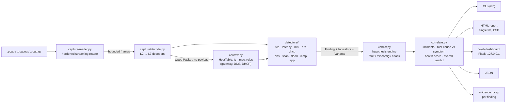

# Faultline

> **Is my network broken, or is someone breaking it?**
>
> Faultline reads a packet capture, finds the faults *and* the attacks hidden in it, tells them apart, and explains every one in plain language: what happened, the likely cause, the fix, and the exact packets that prove it.


 <!-- VERIFY: LICENSE file added by lead -->

 <!-- VERIFY: engine imports nothing outside the stdlib (rich/Flask only in cli.py / web/) -->


**Demo video:** <!-- VIDEO_LINK --> · **Hackathon:** IIITDM Kancheepuram Cybersecurity Club 24-hour hackathon, Network track ("Diagnosing Network Problems from Packet Captures") · **Team:** Yashvanth Sankar (solo)

<!-- SCREENSHOT:dashboard  (hero: web dashboard showing the "Under attack" verdict for samples/mitm_rogue_dhcp.pcap with the incident chain) -->

---

## Try it in 60 seconds

```bash
git clone <REPO_URL> faultline && cd faultline          # <!-- VERIFY: repo URL -->
python3 -m venv .venv && source .venv/bin/activate      # Windows: .venv\Scripts\activate
pip install -e .                                        # <!-- VERIFY: pyproject.toml + `faultline` console script -->
faultline analyze samples/arp_spoofing.pcap             # verdict + findings in the terminal
faultline web                                           # dashboard at http://127.0.0.1:8765
```

No Wireshark, tshark, Scapy, root privileges, network access or API keys are needed. Everything runs locally on Python ≥ 3.10.

---

## The problem

A small office, a lab, a campus department. Nobody there is a network engineer. One morning "the internet is broken": pages load slowly or go to the wrong place, video calls freeze, printers vanish. The office manager does the only thing they know: restart the router, wait, hope.

The honest way to find out what is wrong is to take a packet capture and read it, line by line, in Wireshark. That needs years of protocol knowledge. And it hides a nastier problem: **an outage and an attack look identical to the person suffering them.** Two devices fighting over one IP address and an attacker poisoning the ARP table both produce "the Wi-Fi keeps dropping". A dead DNS server and a DNS hijack both produce "websites don't work". While the manager reboots the router, the attacker who is sitting on the LAN keeps reading the traffic.

The brief asks for a tool that takes a capture file, finds the faults and attacks hidden in the traffic, and explains them in plain language with the likely cause and a suggested fix. Faultline is that tool, and it is built around the question nobody else answers first: **fault or attack?**

## What Faultline does in 30 seconds

```
$ faultline analyze samples/mitm_rogue_dhcp.pcap
<!-- VERIFY: paste real terminal output here once the CLI lands; do not hand-edit it -->
```

Every analysis produces:

1. **A verdict at the top**: `Healthy`, `Minor issues`, `Faulty` or `Under attack`, with a 0 to 100 health score.
2. **Findings**, each with a beginner explanation, an analogy, an expert view, the likely cause, concrete fix steps, the exact frame numbers (same numbering as Wireshark), a confidence value, and, for attacks, a MITRE ATT&CK technique.
3. **For and against reasoning**: each finding is labelled *Fault*, *Misconfiguration* or *Attack*, and shows the evidence that supported the winning hypothesis **and** the evidence that would have supported the alternatives ("why we think this is ARP spoofing and not an IP conflict").
4. **Incidents**: related findings chained into one story with the root cause separated from its symptoms. "A rogue DHCP server handed out a fake DNS server, so DNS answers were hijacked. **Fix the DHCP server first.**"
5. **Evidence you can open in Wireshark**: a tiny per-finding `.pcap` containing only the frames behind that finding.

## Why it's different

Wireshark shows packets. IDSs raise alerts. Both leave the hard part, *interpretation*, to a human expert. Faultline is a **diagnosis engine**, not a packet viewer and not a signature matcher.

| Capability | Wireshark expert info | Zeek | Suricata / Snort | NetworkMiner | **Faultline** |
|---|---|---|---|---|---|
| Finds TCP faults (retrans, resets, zero window, MTU) | Yes | Partly (logs) | No | No | **Yes** |
| Finds attacks (scans, ARP/DNS/DHCP spoofing, floods) | No | Scripts | Signatures | Partly | **Yes** |
| Decides **fault vs. attack** with "why not the other one" reasoning | No | No | No | No | **Yes: competing hypotheses, weighted indicators, counter-evidence shown** |
| Root cause vs. symptom ("fix this first") | No | No | No | No | **Yes: incident chains** |
| Localises loss **upstream / downstream of the capture point** | No | No | No | No | **Yes** <!-- VERIFY: detectors/tcp.py localization landed --> |
| Blame split for "it's slow" (network / server / client / window) | No | No | No | No | **Yes** <!-- VERIFY: detectors/latency.py --> |
| Plain-language explanation + analogy + expert view | No | No | No | No | **Yes, for every finding** |
| Cause and fix steps for every finding | No | No | No | No | **Yes** |
| Per-finding evidence pcap export | Manual | No | No | No | **Yes, one click** |
| Privacy redaction of shareable reports | No | No | No | No | **Yes: `--redact` (HMAC pseudonyms, random key per run)** <!-- VERIFY: report/redact.py --> |
| Before/after diff to prove a fix worked | No | No | No | No | **Yes: `faultline diff`** <!-- VERIFY: cli diff --> |
| Labelled scenario lab + precision/recall/false-alarm benchmark | No | No | No | No | **Yes: `faultline lab`, `faultline bench`** <!-- VERIFY: lab/scenarios.py, bench.py --> |
| Hostile-input hardening, fuzz-tested | n/a | n/a | n/a | n/a | **Yes** (see [Security](#security)) |

Everything above the capture reader is our own code: the pcap/pcapng/gzip reader, every protocol decoder (Ethernet, VLAN, ARP, IPv4/6, TCP with options, UDP, ICMP/v6 with quoted inner header, DNS, DHCP, TLS, HTTP, cleartext authentication) and every detector. **No tshark, Wireshark, Scapy, dpkt or Zeek output is wrapped or parsed.**

## Coverage of the brief

Every challenge point from the problem statement, how Faultline addresses it, and the finding kinds involved.

| Challenge point (from the brief) | How Faultline addresses it | Finding kinds |
|---|---|---|
| **Reading captures safely**: large, broken or malicious input without crashing or leaking data | Own streaming reader; every length checked against remaining bytes and hard caps (record ≤ 256 KiB, pcapng block ≤ 16 MiB, ≤ 10 M packets, 4 GiB file, 2 GiB gzip-decompressed bomb guard); corruption reported with byte offset and the analysis of what was read still completes; payload bytes never retained; fuzz tested | reader warnings, `malformed` counter <!-- VERIFY: fuzz script path --> |
| **TCP retransmissions and resets** | Per-flow state tracker: retransmissions, duplicate ACKs, lost segments, resets, refused connections, SYN timeouts, zero windows, plus upstream/downstream loss localisation | `tcp.retransmissions`, `tcp.resets`, `tcp.refused`, `tcp.syn_timeout`, `tcp.zero_window` <!-- VERIFY: detectors/tcp.py --> |
| **DNS failures** | Query/response matching by transaction ID: timeouts, SERVFAIL/REFUSED, NXDOMAIN bursts, slow resolvers | `dns.timeout`, `dns.errors`, `dns.nxdomain`, `dns.slow` <!-- VERIFY: detectors/dns.py --> |
| **Duplicate IPs / ARP conflicts** | ARP sender claims per IP; stable alternating MACs with probes/DAD = conflict; gateway impersonation, flip-flop, unsolicited replies = spoofing | `arp.duplicate_ip` (conflict vs. spoofing variants), `arp.unanswered`, `arp.scan` <!-- VERIFY: detectors/arp.py --> |
| **MTU mismatches** | ICMP Fragmentation-Needed / Packet-Too-Big, PMTUD black holes (large segments retransmitted with DF set and no ICMP), MSS mismatches | `mtu.frag_needed`, `mtu.blackhole` <!-- VERIFY: detectors/mtu.py --> |
| **Unusual delays** | Handshake RTT, server response time, stalls; blame split: network vs. server vs. client vs. receive window | `latency.high_rtt`, `latency.slow_server` <!-- VERIFY: detectors/latency.py --> |
| **Port scans** | One source → many ports/hosts; SYN, FIN, NULL, Xmas, connect and UDP scans; host and ping sweeps | `scan.port`, `scan.host_sweep` <!-- VERIFY: detectors/scan.py --> |
| **ARP spoofing** | See ARP row; MITRE T1557.002 | `arp.duplicate_ip` (attack variant) |
| **DNS hijacking** | Two answers for one query (race), answers from a server that was never queried, public names resolving to private IPs, TTL anomalies; chained to rogue DHCP/ARP spoofing when present | `dns.hijack`, `dns.tunneling` <!-- VERIFY: detectors/dns.py --> |
| **Rogue DHCP servers** | Second server offering a different router/DNS = rogue; NAK storms / lease mismatch = misconfiguration; no server; starvation | `dhcp.multiple_servers` (rogue vs. misconfigured variants), `dhcp.no_server`, `dhcp.nak`, `dhcp.starvation` <!-- VERIFY: detectors/dhcp.py --> |
| **Telling an outage from an attack, low false alarms** | Hypothesis engine (weighted indicators for fault / misconfig / attack, calibrated confidence); thresholds scaled by `--sensitivity`; clean and busy captures in the benchmark must produce zero findings | all kinds; `verdict.py`, `bench.py` <!-- VERIFY --> |
| **Explaining clearly to a beginner** | Every finding carries `summary`, `explanation`, `analogy` and `technical` (expert) text | all kinds |
| **Recommending fixes** | Every finding carries `cause` and `fix[]`; incidents carry `first_fix` ("fix this first") | all kinds |
| **Showing the evidence** | Frame numbers per finding (Wireshark numbering), hosts and conversations, timeline, per-finding evidence pcap download | all kinds; `report/`, `web/` <!-- VERIFY --> |
| Beyond the brief | Floods, ICMP diagnostics, application-layer problems and cleartext credentials | `flood.syn`, `flood.icmp`, `flood.broadcast`, `icmp.unreachable`, `icmp.routing_loop`, `icmp.redirect`, `cred.cleartext`, `tls.failure`, `tls.deprecated`, `http.errors` <!-- VERIFY: detectors/flood.py, icmp.py, app.py --> |

The full catalogue with signals, thresholds and discriminators is in [`docs/DETECTORS.md`](docs/DETECTORS.md).

## How it works



<!-- VERIFY: module names decode.py, verdict.py, correlate.py, engine.py, cli.py exist with these names -->

**One streaming pass.** The reader yields frames one at a time; the decoder turns each into a compact `Packet` (slots, header fields only, no payload bytes). The host table and every detector observe each packet once. Memory stays bounded by design (`BoundedDict` evicts the oldest flow/host state; `Evidence` keeps at most 200 frame numbers per finding and counts the rest).

**The hypothesis engine.** Detectors do not decide "attack". They describe what they saw as `Indicator(text, supports, weight)` with `supports ∈ {fault, misconfig, attack}` and `weight` from 0.5 (hint) to 3 (near-conclusive), and they provide a `Variant` (title, explanation, cause, fix, MITRE technique) for each plausible reading. The verdict engine then scores each hypothesis as the sum of its indicator weights plus a small prior for the detector's own hint, picks the argmax, turns the margin into a calibrated confidence, and keeps the losing hypotheses with their indicators as the "why not" text. The same logic applies to every detector, so the reasoning is consistent and auditable. <!-- VERIFY: verdict.py formula once landed (softmax margin, [0.5, 0.99]) -->

**Worked example: two MACs claim one IP.**

| Indicator | Supports | Weight |
|---|---|---|
| The contested IP is the **gateway** | attack | 3 |
| One MAC answers with unsolicited replies at a high rate | attack | 2 |
| The same MAC claims **several** IPs | attack | 2 |
| The original MAC keeps talking (flip-flop, not a replacement) | attack | 1 |
| RFC 5227 probes / gratuitous announcements from both devices | fault | 2 |
| Both MACs stable, alternation is rare | fault | 1 |
| Neither MAC is a gateway, host or server role | fault | 1 |

<!-- VERIFY: actual weights in detectors/arp.py -->

Score the columns: a printer that was given a static address inside the DHCP pool lights up the *fault* rows and gets the **Duplicate IP address** variant with the fix "move the printer out of the DHCP range". A laptop impersonating the router lights up the *attack* rows and gets **ARP spoofing (T1557.002)** with the fix "isolate MAC xx, enable Dynamic ARP Inspection / port security". Both explanations show the other side's indicators under *Why not an IP conflict? / Why not ARP spoofing?*.

**Correlation.** Findings sharing hosts or MACs within a time window are grouped into incidents. Chain rules name the story: rogue DHCP or ARP spoofing + DNS hijack → *man-in-the-middle*; no DHCP server → the client's DNS/TCP failures are symptoms; unanswered ARP for the gateway → everything else is a symptom; a scan followed by connections to the opened ports → reconnaissance then access. Symptoms are shown under their root cause with "Fix this first". Health score = 100 − Σ(severity weight × confidence), clamped to 0..100. <!-- VERIFY: correlate.py -->

More on the reasoning in [`docs/THINKING.md`](docs/THINKING.md).

## Quick start (full)

Requirements: Python ≥ 3.10 on macOS, Linux or Windows. No root, no network.

```bash
# 1. Get the code
git clone <REPO_URL> faultline && cd faultline        # <!-- VERIFY: repo URL -->

# 2. Virtual environment
python3 -m venv .venv
source .venv/bin/activate                              # Windows PowerShell: .venv\Scripts\Activate.ps1

# 3. Install (pulls rich, Flask; the engine itself needs nothing)
pip install -e .                                       # <!-- VERIFY: or `pip install -r requirements.txt` + `python -m faultline` -->

# 4. Analyse a capture in the terminal
faultline analyze samples/arp_spoofing.pcap
faultline analyze samples/lossy_link.pcap --html report.html    # self-contained HTML report
faultline analyze samples/mitm_rogue_dhcp.pcap --json > out.json

# 5. Web dashboard (local only): upload a capture or pick a sample
faultline web                                          # http://127.0.0.1:8765

# 6. Prove a fix worked
faultline diff before.pcap after.pcap

# 7. Regenerate the labelled scenario lab and run the benchmark
faultline lab samples/
faultline bench
```

<!-- VERIFY: every subcommand and flag below against the final cli.py -->

| Option | What it does |
|---|---|
| `--html FILE` | Write a single-file HTML report (no external resources, strict CSP) |
| `--json` | Machine-readable report on stdout |
| `--redact` | Pseudonymise IPs, MACs and names with a per-run random HMAC key; disables raw evidence export |
| `--sensitivity low\|normal\|high` | Scales count thresholds (×1.6 / ×1.0 / ×0.6): fewer or more alerts |
| `--fail-on attack\|fault\|any` | Exit code 2 when the verdict reaches that level, for CI pipelines <!-- VERIFY: exit code values --> |
| `--evidence DIR` | Export per-finding evidence pcaps <!-- VERIFY: flag name --> |

If you prefer not to install: `python -m faultline analyze samples/arp_spoofing.pcap` works from the repo root after `pip install rich flask`. <!-- VERIFY: __main__.py exists -->

## Sample captures

All samples are **synthesised by our own scenario lab** (`faultline/lab/`), byte by byte, with labels in `samples/labels.json`. They contain no real user data. <!-- VERIFY: list against samples/labels.json once generated -->

| File | What's inside | Expected verdict |
|---|---|---|
| `clean_office.pcap` | Normal browsing, DNS, DHCP renewals | Healthy (zero findings) |
| `busy_office.pcap` | Heavy legitimate traffic, many flows, a few natural retransmissions | Healthy / minor issues, no attack |
| `lossy_link.pcap` | ~6 % loss downstream of the capture point, video call stalls | Faulty: `tcp.retransmissions` (loss localised downstream) |
| `slow_server.pcap` | Fast network, slow application responses | Faulty: `latency.slow_server` (blame: server) |
| `high_rtt.pcap` | Large handshake RTT on every flow | Faulty: `latency.high_rtt` (blame: network) |
| `zero_window.pcap` | Receiver's window collapses to 0 | Faulty: `tcp.zero_window` (blame: client) |
| `service_down.pcap` | Many clients get RST from one server port | Faulty: `tcp.refused` |
| `syn_timeout.pcap` | SYNs never answered | Faulty: `tcp.syn_timeout` |
| `pmtud_blackhole.pcap` | Large DF segments retransmitted, no ICMP | Faulty: `mtu.blackhole` |
| `frag_needed.pcap` | ICMP Fragmentation Needed from a router | Misconfig: `mtu.frag_needed` |
| `ip_conflict.pcap` | Printer and laptop share one IP, probes/DAD | Fault: `arp.duplicate_ip` (conflict variant) |
| `arp_spoofing.pcap` | Attacker claims the gateway's IP, flip-flop | **Under attack**: `arp.duplicate_ip` (spoofing, T1557.002) |
| `arp_scan.pcap` | One MAC asks for every address in the subnet | Attack: `arp.scan` |
| `gateway_down.pcap` | Unanswered ARP for the gateway, everything else fails | Fault: `arp.unanswered` (root cause) with symptoms |
| `dns_outage.pcap` | Timeouts / SERVFAIL from the configured resolver | Fault: `dns.timeout`, `dns.errors` |
| `dns_hijack.pcap` | Two answers per query, the fake one wins | **Under attack**: `dns.hijack` |
| `dns_tunneling.pcap` | Long high-entropy subdomains, high query rate | Attack: `dns.tunneling` |
| `dhcp_misconfig.pcap` | Two servers with the *same* router/DNS, NAKs | Misconfig: `dhcp.multiple_servers` |
| `mitm_rogue_dhcp.pcap` | Second DHCP server hands out a fake DNS, then DNS hijack | **Under attack**: incident chain `dhcp.multiple_servers` → `dns.hijack` |
| `dhcp_no_server.pcap` | DISCOVERs never answered | Fault: `dhcp.no_server` |
| `dhcp_starvation.pcap` | Thousands of DISCOVERs from random MACs | Attack: `dhcp.starvation` |
| `port_scan_syn.pcap`, `port_scan_xmas.pcap` | nmap-style SYN / Xmas scan | Attack: `scan.port` |
| `host_sweep.pcap` | Ping / SYN sweep across the subnet | Attack: `scan.host_sweep` |
| `syn_flood.pcap` | SYNs from many spoofed sources, none complete | Attack: `flood.syn` |
| `icmp_redirect.pcap` | ICMP redirects pushing a new gateway | Attack: `icmp.redirect` |
| `routing_loop.pcap` | TTL exceeded from the same routers | Fault: `icmp.routing_loop` |
| `cleartext_creds.pcap` | FTP / HTTP Basic logins | Misconfig: `cred.cleartext` (credential never shown) |
| `tls_deprecated.pcap` | TLS 1.0 handshakes, alerts | Misconfig: `tls.deprecated`, `tls.failure` |
| `malformed/*.pcap` | Truncated files, giant length fields, pcapng loops, gzip bomb, DNS pointer loops | Reader warnings, no crash |

## Benchmark

`faultline bench` runs every labelled scenario through the engine and reports, per finding kind, precision, recall and the false-alarm rate measured on clean and busy captures. The table below is generated by that command; it is never hand-edited.

<!-- BENCH_TABLE -->

<!-- VERIFY: paste the output of `faultline bench --markdown` (or equivalent) before submission -->

## Security

Capture files are treated as hostile input from the first byte to the last pixel of the report.

- **Reader**: magic and version validation; every length checked against remaining bytes and hard caps; corruption ends iteration gracefully with an offset in the warnings, never a traceback; gzip is streamed through a decompressed-size guard.
- **Decoders**: bounds-checked everywhere; a malformed packet is counted and flagged, not raised; DNS name decompression has pointer-loop and depth limits; option/TLV loops are capped.
- **Data handling**: payload bytes are never retained; credentials are detected but **never stored or displayed** (only the protocol name); `--redact` pseudonymises with a random per-run HMAC key that is never written anywhere.
- **Reports and web**: all capture-derived strings are untrusted; Jinja2 autoescape; embedded JSON escapes `<`, `>` and `&`; the report's JavaScript renders via `textContent` only; strict Content-Security-Policy; no external resources, no CDN. The dashboard binds to 127.0.0.1, limits upload size, validates extension and magic bytes, stores uploads under random temp names and deletes them after analysis.
- **Supply chain**: no secrets, no network calls, no telemetry, no `eval`, `pickle` or shell execution. The engine uses the standard library only.
- **Tests**: a fuzz harness mutates valid captures and feeds hand-crafted malicious files; it asserts no exceptions and bounded time.

Details, threat model and how to report an issue: [`SECURITY.md`](SECURITY.md). <!-- VERIFY: SECURITY.md written by the security engineer -->

## Project structure

```
faultline/
  capture/reader.py     hardened streaming pcap / pcapng / gzip reader
  capture/decode.py     Ethernet/VLAN/SLL/Raw/Null → ARP, IPv4/6, TCP, UDP, ICMP/v6, DNS, DHCP, TLS, HTTP, cleartext auth
  capture/writer.py     pcap / pcapng writer (evidence export, lab)
  model.py              Packet (slots), Finding, Indicator, Variant, Severity, Category, Incident
  context.py            AnalysisContext, HostTable (ip↔mac, roles), Config (sensitivity)
  detectors/base.py     Detector interface, registry, Evidence, BoundedDict
  detectors/tcp.py      retransmissions, dup-ACK, lost segments, RST, refused, zero window, SYN timeout, loss localisation
  detectors/latency.py  handshake RTT, server response time, stalls, blame split
  detectors/mtu.py      frag-needed / PTB, PMTUD black hole, MSS mismatch
  detectors/arp.py      IP conflict vs ARP spoofing, ARP scan, unanswered ARP
  detectors/dhcp.py     rogue vs misconfigured server, no server, NAK, starvation
  detectors/dns.py      timeouts, rcodes, slow, NXDOMAIN, hijack, tunneling
  detectors/scan.py     SYN/FIN/NULL/Xmas/connect/UDP scans, host sweeps
  detectors/flood.py    SYN flood, ICMP flood, broadcast storm
  detectors/icmp.py     unreachables, TTL exceeded / routing loop, redirects
  detectors/app.py      TLS alerts / deprecated TLS, HTTP errors, cleartext credentials
  verdict.py            hypothesis engine (fault / misconfig / attack + "why not")
  correlate.py          incidents, root cause vs symptom, health score, overall verdict
  engine.py             analyze(path, options) → Report
  report/               terminal (rich), html (single file), json, redact
  web/                  Flask dashboard (upload, samples, report, evidence download)
  lab/                  byte-level packet builders + labelled scenario generators
  bench.py              precision / recall / false-alarm benchmark
  cli.py                analyze | web | diff | lab | bench
samples/                generated captures + labels.json (+ malformed/)
tests/                  pytest unit tests, factory for decoded packets, fuzz harness
docs/                   THINKING.md, DETECTORS.md, demo-script.md
```

<!-- VERIFY: tree against the final repo -->

## Testing

```bash
pip install pytest
pytest -q                                   # unit tests: reader, decoders, each detector, verdict, correlation
python tests/fuzz.py --iterations 2000      # <!-- VERIFY: fuzz script path and flags -->
faultline bench                             # end-to-end accuracy on the labelled lab
```

Detector tests build decoded `Packet` objects directly through `tests/factory.py`, so each detector is tested in isolation without capture files; reader and decoder tests use real bytes, including the malformed samples.

## Libraries used

The brief requires a complete list. Faultline's **analysis engine (reader, decoders, detectors, verdict, correlation) uses only the Python standard library**: `struct`, `gzip`, `io`, `os`, `stat`, `ipaddress`, `collections`, `dataclasses`, `enum`, `functools`, `hmac`, `hashlib`, `secrets`, `json`, `math`, `statistics`, `time`, `argparse`, `pathlib`, `tempfile`, `html`, `typing`. <!-- VERIFY: trim to the modules actually imported -->

Third-party, open source, used only for presentation and tests:

| Library | License | Used for |
|---|---|---|
| [rich](https://github.com/Textualize/rich) | MIT | Terminal output of the CLI (tables, colours) |
| [Flask](https://github.com/pallets/flask) | BSD-3 | Local web dashboard |
| [Jinja2](https://github.com/pallets/jinja) (Flask dependency) | BSD-3 | HTML templating with autoescape |
| [Werkzeug](https://github.com/pallets/werkzeug) (Flask dependency) | BSD-3 | WSGI server / request handling |
| [MarkupSafe](https://github.com/pallets/markupsafe), [itsdangerous](https://github.com/pallets/itsdangerous), [click](https://github.com/pallets/click), [blinker](https://github.com/pallets-eco/blinker) (Flask dependencies) | BSD-3 / MIT | Transitive dependencies of Flask |
| [pytest](https://github.com/pytest-dev/pytest) | MIT | Tests (development only) |

<!-- VERIFY: match pyproject.toml exactly; remove any entry not actually depended on -->

**Not used:** Wireshark, tshark, pyshark, Scapy, dpkt, Zeek, Suricata, any external API or network service. Capture parsing, protocol decoding and all detection and diagnosis logic are original code written for this hackathon.

## Responsible use

Faultline is a defensive diagnostic tool. Only analyse captures you are authorised to hold. Credentials found in cleartext are reported by protocol only and never extracted, stored or displayed. Use `--redact` before sharing a report outside your team. The scenario lab generates synthetic traffic in files; it never transmits anything.

## Limitations and future work

Honest notes for the judges:

- **Encrypted content is opaque.** Faultline reads TLS handshakes (versions, SNI, alerts) but not encrypted payloads. It cannot find an attack that lives entirely inside a correctly encrypted session.
- **Capture point matters.** Loss localisation and RTT blame assume a single capture point; a merged multi-point capture will confuse upstream/downstream reasoning.
- **Thresholds are heuristics.** Tuned on our lab and on clean/busy captures; `--sensitivity` adjusts them, but real networks vary. Precision is prioritised over recall on purpose.
- **No live capture.** Faultline analyses files. Reading from an interface is a thin addition we chose not to spend hackathon hours on.
- **Protocol breadth.** Decoders cover ARP, IPv4/6, TCP, UDP, ICMP/v6, DNS, DHCPv4, TLS and HTTP/1.x. DHCPv6, QUIC, SMB, mDNS and IPv6 NDP spoofing are natural next steps.
- **Role inference is heuristic.** The gateway is inferred from DHCP options and from the MAC that fronts many public addresses; in a capture with no outside traffic and no DHCP, gateway-based indicators do not fire.

With more time: IPv6 NDP spoofing detection, flow-level baselines learned from a known-good capture, a Wireshark-compatible display filter per finding, PDF export, and a plug-in API for third-party detectors.

## Author

**Yashvanth Sankar**, solo entry. IIITDM Kancheepuram Cybersecurity Club 24-hour hackathon, Network track, November 2026.

## License

MIT. See [`LICENSE`](LICENSE). <!-- VERIFY: LICENSE file -->
