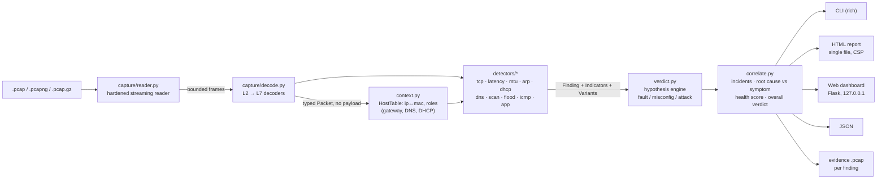

# Faultline

> **Is my network broken, or is someone breaking it?**
>
> Faultline reads a packet capture, finds the faults *and* the attacks hidden in it, tells them apart, and explains every one in plain language: what happened, the likely cause, the fix, and the exact packets that prove it.


**Demo video:** <!-- VIDEO_LINK --> · **Hackathon:** IIITDM Kancheepuram Cybersecurity Club 24-hour hackathon, Network track ("Diagnosing Network Problems from Packet Captures") · **Team:** Moorthy Gang — Yashvanth S (CS24I1029), team leader (solo team)

<!-- SCREENSHOT:dashboard  (hero: web dashboard showing the "Under attack" verdict for samples/mitm_rogue_dhcp.pcap with the incident chain) -->

---

## Try it in 60 seconds

```bash
git clone <REPO_URL> faultline && cd faultline          # <!-- VERIFY: repo URL -->
python3 -m venv .venv && source .venv/bin/activate      # Windows: .venv\Scripts\activate
pip install -e .                                        # installs rich + flask and the `faultline` command
faultline analyze samples/ip_conflict.pcap              # verdict + findings in the terminal
faultline analyze samples/arp_spoofing.pcap             # <!-- VERIFY: attack sample not generated yet -->
faultline web                                           # dashboard at http://127.0.0.1:8765
```

No Wireshark, tshark, Scapy, root privileges, network access or API keys are needed. Everything runs locally on Python ≥ 3.10.

---

## The problem

A small office, a lab, a campus department. Nobody there is a network engineer. One morning "the internet is broken": pages load slowly or go to the wrong place, video calls freeze, printers vanish. The office manager does the only thing they know: restart the router, wait, hope.

The honest way to find out what is wrong is to take a packet capture and read it, line by line, in Wireshark. That needs years of protocol knowledge. And it hides a nastier problem: **an outage and an attack look identical to the person suffering them.** Two devices fighting over one IP address and an attacker poisoning the ARP table both produce "the Wi-Fi keeps dropping". A dead DNS server and a DNS hijack both produce "websites don't work". While the manager reboots the router, the attacker who is sitting on the LAN keeps reading the traffic.

The brief asks for a tool that takes a capture file, finds the faults and attacks hidden in the traffic, and explains them in plain language with the likely cause and a suggested fix. Faultline is that tool, and it is built around the question nobody else answers first: **fault or attack?**

## What Faultline does in 30 seconds

```
$ faultline analyze samples/mitm_rogue_dhcp.pcap    # <!-- VERIFY: sample not generated yet; use whichever attack sample ships -->
<!-- VERIFY: paste real output of `faultline analyze samples/mitm_rogue_dhcp.pcap --no-color` once samples exist; do not hand-edit it -->
```

Every analysis produces:

1. **A verdict at the top**: `Healthy`, `Minor issues`, `Faulty` or `Under attack`, with a 0 to 100 health score.
2. **Findings**, each with a beginner explanation, an analogy, an expert view, the likely cause, concrete fix steps, the exact frame numbers (same numbering as Wireshark), a confidence value, and, for attacks, a MITRE ATT&CK technique.
3. **For and against reasoning**: each finding is labelled *Fault*, *Misconfiguration* or *Attack*, and shows the evidence that supported the winning hypothesis **and** the evidence that would have supported the alternatives ("why we think this is ARP spoofing and not an IP conflict").
4. **Incidents**: related findings chained into one story with the root cause separated from its symptoms. "A rogue DHCP server handed out a fake DNS server, so DNS answers were hijacked. **Fix the DHCP server first.**"
5. **Evidence you can open in Wireshark**: a tiny per-finding `.pcap` containing only the frames behind that finding.

## Why it's different

Wireshark shows packets. IDSs raise alerts. Both leave the hard part, *interpretation*, to a human expert. Faultline is a **diagnosis engine**, not a packet viewer and not a signature matcher.

| Capability | Wireshark expert info | Zeek | Suricata / Snort | NetworkMiner | **Faultline** |
|---|---|---|---|---|---|
| Finds TCP faults (retrans, resets, zero window, MTU) | Yes | Partly (logs) | No | No | **Yes** |
| Finds attacks (scans, ARP/DNS/DHCP spoofing, floods) | No | Scripts | Signatures | Partly | **Yes** |
| Decides **fault vs. attack** with "why not the other one" reasoning | No | No | No | No | **Yes: competing hypotheses, weighted indicators, counter-evidence shown** |
| Root cause vs. symptom ("fix this first") | No | No | No | No | **Yes: incident chains** |
| Localises loss **upstream / downstream of the capture point** | No | No | No | No | **Yes** (before / after the capture point) |
| Blame split for "it's slow" (network / server / client / window) | No | No | No | No | **Yes** |
| Plain-language explanation + analogy + expert view | No | No | No | No | **Yes, for every finding** |
| Cause and fix steps for every finding | No | No | No | No | **Yes** |
| Per-finding evidence pcap export | Manual | No | No | No | **Yes, one click** |
| Privacy redaction of shareable reports | No | No | No | No | **Yes: `--redact` (HMAC-SHA256 pseudonyms, random 32-byte key per run)** |
| Before/after diff to prove a fix worked | No | No | No | No | **Yes: `faultline diff`** |
| Labelled scenario lab + precision/recall/false-alarm benchmark | No | No | No | No | **Yes: `faultline lab`, `faultline bench`** |
| Hostile-input hardening, fuzz-tested | n/a | n/a | n/a | n/a | **Yes** (see [Security](#security)) |

Everything above the capture reader is our own code: the pcap/pcapng/gzip reader, every protocol decoder (Ethernet, VLAN, ARP, IPv4/6, TCP with options, UDP, ICMP/v6 with quoted inner header, DNS, DHCP, TLS, HTTP, cleartext authentication) and every detector. **No tshark, Wireshark, Scapy, dpkt or Zeek output is wrapped or parsed.**

## Coverage of the brief

Every challenge point from the problem statement, how Faultline addresses it, and the finding kinds involved.

| Challenge point (from the brief) | How Faultline addresses it | Finding kinds |
|---|---|---|
| **Reading captures safely**: large, broken or malicious input without crashing or leaking data | Own streaming reader; every length checked against remaining bytes and hard caps (record ≤ 256 KiB, pcapng block ≤ 16 MiB, ≤ 10 M packets, 4 GiB file, 2 GiB gzip-decompressed bomb guard); corruption reported with byte offset and the analysis of what was read still completes; payload bytes never retained; fuzz tested | reader warnings, `malformed` counter (`tests/test_fuzz.py`) |
| **TCP retransmissions and resets** | Per-flow state tracker: retransmissions, duplicate ACKs, lost segments, resets, refused connections, SYN timeouts, zero windows, plus upstream/downstream loss localisation | `tcp.retransmissions`, `tcp.resets`, `tcp.refused`, `tcp.syn_timeout`, `tcp.zero_window` |
| **DNS failures** | Query/response matching by transaction ID: timeouts, SERVFAIL/REFUSED, NXDOMAIN bursts, slow resolvers | `dns.timeout`, `dns.errors`, `dns.nxdomain`, `dns.slow` |
| **Duplicate IPs / ARP conflicts** | ARP sender claims per IP; stable alternating MACs with probes/DAD = conflict; gateway impersonation, flip-flop, unsolicited replies = spoofing | `arp.duplicate_ip` (conflict vs. spoofing variants), `arp.unanswered`, `arp.scan`, `arp.storm` |
| **MTU mismatches** | ICMP Fragmentation-Needed / Packet-Too-Big, PMTUD black holes (large segments retransmitted with DF set and no ICMP), MSS mismatches | `mtu.frag_needed`, `mtu.blackhole` |
| **Unusual delays** | Handshake RTT, server response time, stalls; blame split: network vs. server vs. client vs. receive window | `latency.high_rtt`, `latency.slow_server` |
| **Port scans** | One source → many ports/hosts; SYN, FIN, NULL, Xmas, connect and UDP scans; host and ping sweeps | `scan.port`, `scan.host_sweep` |
| **ARP spoofing** | See ARP row; MITRE T1557.002 | `arp.duplicate_ip` (attack variant) |
| **DNS hijacking** | Two answers for one query (race), answers from a server that was never queried, public names resolving to private IPs, TTL anomalies; chained to rogue DHCP/ARP spoofing when present | `dns.hijack`, `dns.tunneling` |
| **Rogue DHCP servers** | Second server offering a different router/DNS = rogue; NAK storms / lease mismatch = misconfiguration; no server; starvation | `dhcp.multiple_servers` (rogue vs. misconfigured variants), `dhcp.no_server`, `dhcp.nak`, `dhcp.starvation` |
| **Telling an outage from an attack, low false alarms** | Hypothesis engine (weighted indicators for fault / misconfig / attack, calibrated confidence); thresholds scaled by `--sensitivity`; clean and busy captures in the benchmark must produce zero findings | all kinds; `verdict.py`, `bench.py` |
| **Explaining clearly to a beginner** | Every finding carries `summary`, `explanation`, `analogy` and `technical` (expert) text | all kinds |
| **Recommending fixes** | Every finding carries `cause` and `fix[]`; incidents carry `first_fix` ("fix this first") | all kinds |
| **Showing the evidence** | Frame numbers per finding (Wireshark numbering), hosts and conversations, timeline, per-finding evidence pcap download | all kinds; `report/html.py`, `web/app.py` <!-- VERIFY: per-finding evidence download route in the web UI (not found in app.py at time of writing; HTML report + --evidence-dir do provide it) --> |
| Beyond the brief | Floods, ICMP diagnostics, application-layer problems and cleartext credentials | `flood.syn`, `flood.icmp`, `flood.broadcast`, `icmp.unreachable`, `icmp.routing_loop`, `icmp.redirect`, `cred.cleartext`, `tls.failure`, `tls.deprecated`, `http.errors` <!-- VERIFY: detectors/app.py (cred.cleartext, tls.*, http.errors) not landed at time of writing; remove these kinds if it does not ship --> |

The full catalogue with signals, thresholds and discriminators is in [`docs/DETECTORS.md`](docs/DETECTORS.md).

## How it works




**One streaming pass.** The reader yields frames one at a time; the decoder turns each into a compact `Packet` (slots, header fields only, no payload bytes). The host table and every detector observe each packet once. Memory stays bounded by design (`BoundedDict` evicts the oldest flow/host state; `Evidence` keeps at most 200 frame numbers per finding and counts the rest).

**The hypothesis engine.** Detectors do not decide "attack". They describe what they saw as `Indicator(text, supports, weight)` with `supports ∈ {fault, misconfig, attack}` and `weight` from 0.5 (hint) to 3 (near-conclusive), and they provide a `Variant` (title, explanation, cause, fix, MITRE technique) for each plausible reading. The verdict engine then scores each hypothesis as the sum of its indicator weights plus a small prior for the detector's own hint, picks the argmax, turns the margin into a calibrated confidence, and keeps the losing hypotheses with their indicators as the "why not" text. The same logic applies to every detector, so the reasoning is consistent and auditable. Concretely (`verdict.py`): prior 0.5, indicator weights clamped to 3, softmax over the candidate hypotheses, confidence clamped to [0.5, 0.99]; a weakly supported attack reading (confidence < 0.6) is shown one severity step softer, and ties go to the detector's default reading.

**Worked example: two MACs claim one IP.**

| Indicator | Supports | Weight |
|---|---|---|
| The disputed address belongs to the router (default gateway) | attack | 2.0 |
| The suspicious MAC sent replies nobody asked for, repeating like clockwork | attack | scales with count |
| The suspicious MAC answered ARP for several other devices' IPs / has its own different address | attack | — |
| The owner flipped between two MACs while the original stayed alive; internet traffic is being relayed through the newcomer | attack | — |
| A device probed the address first (RFC 5227) or announced once with a gratuitous ARP | misconfig | — |
| The suspicious MAC only answered when asked, claims only this one address | misconfig | 1.0 each |
| The disputed address is not the router's; both MACs stable | misconfig | 1.0 / 0.5 |

(Indicator texts are paraphrased from `detectors/arp.py`; the full list, including VRRP/HSRP exclusions, is in [`docs/DETECTORS.md`](docs/DETECTORS.md).)

Score the columns: a printer that was given a static address inside the DHCP pool lights up the *misconfig* rows and gets the **Duplicate IP address** variant with the fix "move the printer out of the DHCP range". A laptop impersonating the router lights up the *attack* rows and gets **ARP spoofing (T1557.002)** with the fix "isolate MAC xx, enable Dynamic ARP Inspection / port security". Both explanations show the other side's indicators under *Why not an IP conflict? / Why not ARP spoofing?*.

**Correlation.** Findings sharing hosts or MACs within a time window are grouped into incidents. Chain rules name the story: rogue DHCP or ARP spoofing + DNS hijack → *man-in-the-middle*; no DHCP server → the client's DNS/TCP failures are symptoms; unanswered ARP for the gateway → everything else is a symptom; a scan followed by connections to the opened ports → reconnaissance then access. Symptoms are shown under their root cause with "Fix this first". Health score = 100 − Σ(severity penalty × confidence), where penalties are 3 / 9 / 18 / 30 for low / medium / high / critical and symptoms count at 40 %, clamped to 0..100 (`correlate.py`).

More on the reasoning in [`docs/THINKING.md`](docs/THINKING.md).

## Quick start (full)

Requirements: Python ≥ 3.10 on macOS, Linux or Windows. No root, no network.

```bash
# 1. Get the code
git clone <REPO_URL> faultline && cd faultline        # <!-- VERIFY: repo URL -->

# 2. Virtual environment
python3 -m venv .venv
source .venv/bin/activate                              # Windows PowerShell: .venv\Scripts\Activate.ps1

# 3. Install (pulls rich, Flask; the engine itself needs nothing)
pip install -e .                                       # or: pip install -r requirements.txt && python -m faultline ...

# 4. Analyse a capture in the terminal
faultline analyze samples/ip_conflict.pcap
faultline analyze samples/lossy_link.pcap --html report.html    # self-contained HTML report
faultline analyze samples/dns_failure.pcap --json out.json       # or `--json -` for stdout
faultline analyze samples/mitm_rogue_dhcp.pcap                   # <!-- VERIFY: attack sample not generated yet -->

# 5. Web dashboard (local only): upload a capture or pick a sample
faultline web                                          # http://127.0.0.1:8765

# 6. Prove a fix worked
faultline diff before.pcap after.pcap

# 7. Regenerate the labelled scenario lab and run the benchmark
faultline lab samples/
faultline bench
```

Subcommands: `analyze` (alias `a`), `web`, `diff`, `lab`, `bench`. Global: `--version`, `--no-color`.

| Option | What it does |
|---|---|
| `--html FILE` | Write a single-file HTML report (no external resources, strict CSP) |
| `--json FILE` | Full report as JSON (`-` for stdout) |
| `--redact` | Pseudonymise IPs and MACs with a per-run random HMAC-SHA256 key (safe to share); raw evidence pcaps are not exported in this mode |
| `--sensitivity low\|normal\|high` | Scales count thresholds (×1.6 / ×1.0 / ×0.6): fewer or more alerts |
| `--fail-on attack\|fault\|any\|never` | Exit status 1 when findings of that category (severity ≥ medium) exist, for CI pipelines. Exit 2 = unusable input |
| `--evidence-dir DIR` | Write one small evidence `.pcap` per finding (named `F1-arp.duplicate_ip.pcap`, mode 0600) |
| `--expert` | Technical details, all indicators, informational notes, host table |
| `--quiet` / `-q` | No terminal report (use with `--json` / `--html`) |
| `--max-packets N`, `--no-evidence` | Bound the work: stop after N packets, skip the evidence pass |
| `web --host --port --no-browser` | Dashboard defaults: 127.0.0.1:8765, opens your browser |

If you prefer not to install: `python -m faultline analyze samples/arp_spoofing.pcap` works from the repo root after `pip install -r requirements.txt`.

## Sample captures

All samples are **synthesised by our own scenario lab** (`faultline/lab/scenarios.py`), byte by byte, with labels in `samples/labels.json`. They contain no real user data. Regenerate with `faultline lab samples/`.

<!-- VERIFY: CRITICAL. At the time of writing, labels.json contains fault/misconfig scenarios and hostile files only. The attack scenarios referenced in the Quick start and in docs/demo-script.md (arp_spoofing, mitm_rogue_dhcp, dns_hijack, port_scan_syn, syn_flood, dhcp_starvation, icmp_redirect, cleartext_creds ...) do not exist yet. Either add them to lab/scenarios.py or change the commands. Rows below marked "planned" must be deleted if not generated. -->

| File | What's inside | Expected finding(s) |
|---|---|---|
| `clean_office.pcap` | Clean office afternoon: browsing, DNS, DHCP | none (Healthy) |
| `busy_but_healthy.pcap` | Heavy legitimate traffic, natural noise | none (Healthy): the false-alarm guard |
| `pcapng_office.pcapng` | Clean office in pcapng format | none (Healthy) |
| `lossy_link.pcap` | Lossy Wi-Fi link | `tcp.retransmissions` (fault), loss localised relative to the capture point |
| `connection_refused.pcap` | Database connection refused | `tcp.refused` (misconfig) |
| `server_down_timeouts.pcap` | Server down, printer unplugged | `tcp.syn_timeout`, `arp.unanswered` (fault) |
| `zero_window.pcap` | Receiver stalls | `tcp.zero_window` (fault, blame: client) |
| `slow_server.pcap` | Slow application server | `latency.slow_server` (fault, blame: server) |
| `high_latency.pcap` | Satellite-grade latency | `latency.high_rtt` (fault, blame: network) |
| `mtu_blackhole.pcap` | Path MTU black hole | `mtu.blackhole` (misconfig) |
| `mtu_frag_needed.pcap` | Fragmentation needed on a VPN path | `mtu.frag_needed` (misconfig) |
| `ip_conflict.pcap` | Two devices share 192.168.1.23 | `arp.duplicate_ip` (misconfig: conflict, **not** spoofing) |
| `dns_failure.pcap` | Resolver stops answering | `dns.timeout`, `dns.errors` (fault) |
| `dhcp_misconfig_two_routers.pcap` | Second DHCP server from a home router | `dhcp.multiple_servers` (misconfig, **not** rogue) |
| `dhcp_no_server.pcap` | No DHCP server | `dhcp.no_server` (fault) |
| `routing_loop.pcap` | Routing loop between two routers | `icmp.routing_loop` (fault) |
| `malformed/truncated.pcap` | Capture cut mid-record | handled: warning with offset, partial analysis |
| `malformed/bad_magic.pcap` | Random bytes, not a capture | rejected cleanly (`CaptureError`) |
| `malformed/huge_caplen.pcap` | Record claims a 2 GiB length | handled: length cap |
| `malformed/zero_length.pcap` | Empty file | rejected cleanly |
| `malformed/corrupt_packets.pcap` | Valid file, garbage frames inside | handled: frames flagged `malformed`, analysis completes |
| `malformed/compressed_padding.pcap.gz` | Decompression bomb-ish gzip | handled: streamed through the size guard |
| *planned:* `arp_spoofing.pcap` | Attacker claims the gateway's IP, flip-flop | `arp.duplicate_ip` (attack, T1557.002) <!-- VERIFY: not generated yet --> |
| *planned:* `mitm_rogue_dhcp.pcap` | Rogue DHCP hands out a fake DNS, then hijacked answers | `dhcp.multiple_servers` → `dns.hijack` incident (attack) <!-- VERIFY: not generated yet --> |
| *planned:* `dns_hijack.pcap`, `dns_tunneling.pcap` | Two answers per query; long high-entropy names | `dns.hijack`, `dns.tunneling` (attack) <!-- VERIFY: not generated yet --> |
| *planned:* `port_scan_syn.pcap`, `host_sweep.pcap`, `arp_scan.pcap` | nmap-style scan / sweep | `scan.port`, `scan.host_sweep`, `arp.scan` (attack) <!-- VERIFY: not generated yet --> |
| *planned:* `syn_flood.pcap`, `dhcp_starvation.pcap`, `icmp_redirect.pcap` | Floods and redirects | `flood.syn`, `dhcp.starvation`, `icmp.redirect` (attack) <!-- VERIFY: not generated yet --> |

## Benchmark

`faultline bench` runs every labelled scenario through the engine and reports, per finding kind, precision, recall and the false-alarm rate measured on clean and busy captures. The table below is generated by that command; it is never hand-edited.

<!-- BENCH_TABLE -->

<!-- VERIFY: paste the table printed by `faultline bench` (or `faultline bench --json` rendered to Markdown) before submission -->

## Security

Capture files are treated as hostile input from the first byte to the last pixel of the report.

- **Reader**: magic and version validation; every length checked against remaining bytes and hard caps; corruption ends iteration gracefully with an offset in the warnings, never a traceback; gzip is streamed through a decompressed-size guard.
- **Decoders**: bounds-checked everywhere; a malformed packet is counted and flagged, not raised; DNS name decompression has pointer-loop and depth limits; option/TLV loops are capped.
- **Data handling**: payload bytes are never retained; credentials are detected but **never stored or displayed** (only the protocol name); `--redact` pseudonymises with a random per-run HMAC key that is never written anywhere.
- **Reports and web**: all capture-derived strings are untrusted; Jinja2 autoescape; embedded JSON escapes `<`, `>` and `&`; the report's JavaScript renders via `textContent` only; strict Content-Security-Policy; no external resources, no CDN. The dashboard binds to 127.0.0.1, limits upload size, validates extension and magic bytes, stores uploads under random temp names and deletes them after analysis.
- **Supply chain**: no secrets, no network calls, no telemetry, no `eval`, `pickle` or shell execution. The engine uses the standard library only.
- **Tests**: a fuzz harness mutates valid captures and feeds hand-crafted malicious files; it asserts no exceptions and bounded time.

Details, threat model and how to report an issue: [`SECURITY.md`](SECURITY.md). A secret scanner (`scripts/check_secrets.py`) runs over the repo.

## Project structure

```
faultline/
  capture/reader.py     hardened streaming pcap / pcapng / gzip reader
  capture/decode.py     Ethernet/VLAN/SLL/Raw/Null → ARP, IPv4/6, TCP, UDP, ICMP/v6, DNS, DHCP, TLS, HTTP, cleartext auth
  capture/writer.py     pcap / pcapng writer (evidence export, lab)
  model.py              Packet (slots), Finding, Indicator, Variant, Severity, Category, Incident
  context.py            AnalysisContext, HostTable (ip↔mac, roles), Config (sensitivity)
  detectors/base.py     Detector interface, registry, Evidence, BoundedDict
  detectors/tcp.py      retransmissions, dup-ACK, lost segments, RST, refused, zero window, SYN timeout, loss localisation
  detectors/latency.py  handshake RTT, server response time, stalls, blame split
  detectors/mtu.py      frag-needed / PTB, PMTUD black hole, MSS mismatch
  detectors/arp.py      IP conflict vs ARP spoofing, ARP scan, unanswered ARP
  detectors/dhcp.py     rogue vs misconfigured server, no server, NAK, starvation
  detectors/dns.py      timeouts, rcodes, slow, NXDOMAIN, hijack, tunneling
  detectors/scan.py     SYN/FIN/NULL/Xmas/connect/UDP scans, host sweeps
  detectors/flood.py    SYN flood, ICMP flood, broadcast storm
  detectors/icmp.py     unreachables, TTL exceeded / routing loop, redirects
  detectors/app.py      TLS alerts / deprecated TLS, HTTP errors, cleartext credentials
  verdict.py            hypothesis engine (fault / misconfig / attack + "why not")
  correlate.py          incidents, root cause vs symptom, health score, overall verdict
  engine.py             analyze(path, options) → Report
  report/               terminal (rich), html (single file), json, redact
  web/                  Flask dashboard (upload, samples gallery, CSRF token, CSP, 200 MB upload cap)
  lab/                  byte-level packet builders + labelled scenario generators
  bench.py              precision / recall / false-alarm benchmark
  cli.py                analyze | web | diff | lab | bench
samples/                generated captures + labels.json (+ malformed/)
tests/                  pytest unit tests, factory for decoded packets, fuzz harness
scripts/                fuzz.py (standalone fuzzer), check_secrets.py
docs/                   THINKING.md, DETECTORS.md, demo-script.md
SECURITY.md             threat model and hardening details
```

<!-- VERIFY: tree against the final repo -->

## Testing

```bash
pip install pytest
pytest -q                                   # unit tests: reader, decoders, each detector, verdict, correlation
pytest tests/test_fuzz.py -q                # mutation fuzzing: reader → decoder → engine; only CaptureError may escape
python scripts/fuzz.py -n 2000 --keep out/  # standalone fuzzer: N mutated cases, 3 s budget each, saves crashers
python scripts/check_secrets.py             # no hardcoded secrets
faultline bench                             # end-to-end accuracy on the labelled lab
```

Detector tests build decoded `Packet` objects directly through `tests/factory.py`, so each detector is tested in isolation without capture files; reader and decoder tests use real bytes, including the malformed samples.

## Libraries used

The brief requires a complete list. Faultline's **analysis engine (reader, decoders, detectors, verdict, correlation) uses only the Python standard library**: `struct`, `gzip`, `io`, `os`, `stat`, `ipaddress`, `collections`, `dataclasses`, `enum`, `functools`, `hmac`, `hashlib`, `secrets`, `json`, `math`, `statistics`, `time`, `argparse`, `html`, `re`, `socket`, `zlib`, `base64`, `typing`. <!-- VERIFY: trim to the modules actually imported once all modules land -->

Third-party, open source, used only for presentation and tests:

| Library | License | Used for |
|---|---|---|
| [rich](https://github.com/Textualize/rich) | MIT | Terminal output of the CLI (tables, colours) |
| [Flask](https://github.com/pallets/flask) | BSD-3 | Local web dashboard |
| [Jinja2](https://github.com/pallets/jinja) (Flask dependency) | BSD-3 | HTML templating with autoescape |
| [Werkzeug](https://github.com/pallets/werkzeug) (Flask dependency) | BSD-3 | WSGI server / request handling |
| [MarkupSafe](https://github.com/pallets/markupsafe), [itsdangerous](https://github.com/pallets/itsdangerous), [click](https://github.com/pallets/click), [blinker](https://github.com/pallets-eco/blinker) (Flask dependencies) | BSD-3 / MIT | Transitive dependencies of Flask |
| [pytest](https://github.com/pytest-dev/pytest) | MIT | Tests (development only) |

Declared in `pyproject.toml`: `rich>=13`, `flask>=3.0`; dev: `pytest>=8`. The others listed are Flask's own transitive dependencies.

**Not used:** Wireshark, tshark, pyshark, Scapy, dpkt, Zeek, Suricata, any external API or network service. Capture parsing, protocol decoding and all detection and diagnosis logic are original code written for this hackathon.

## Responsible use

Faultline is a defensive diagnostic tool. Only analyse captures you are authorised to hold. Credentials found in cleartext are reported by protocol only and never extracted, stored or displayed. Use `--redact` before sharing a report outside your team. The scenario lab generates synthetic traffic in files; it never transmits anything.

## Limitations and future work

Honest notes for the judges:

- **Encrypted content is opaque.** Faultline reads TLS handshakes (versions, SNI, alerts) but not encrypted payloads. It cannot find an attack that lives entirely inside a correctly encrypted session.
- **Capture point matters.** Loss localisation and RTT blame assume a single capture point; a merged multi-point capture will confuse upstream/downstream reasoning.
- **Thresholds are heuristics.** Tuned on our lab and on clean/busy captures; `--sensitivity` adjusts them (×1.6 / ×1.0 / ×0.6), but real networks vary. Precision is prioritised over recall on purpose.
- **No live capture.** Faultline analyses files. Reading from an interface is a thin addition we chose not to spend hackathon hours on.
- **Protocol breadth.** Decoders cover ARP, IPv4/6, TCP, UDP, ICMP/v6, DNS, DHCPv4, TLS and HTTP/1.x. DHCPv6, QUIC, SMB, mDNS and IPv6 NDP spoofing are natural next steps.
- **Role inference is heuristic.** The gateway is inferred from DHCP options and from the MAC that fronts many public addresses; in a capture with no outside traffic and no DHCP, gateway-based indicators do not fire.

With more time: IPv6 NDP spoofing detection, flow-level baselines learned from a known-good capture, a Wireshark-compatible display filter per finding, PDF export, and a plug-in API for third-party detectors.

## Team

**Moorthy Gang**: Yashvanth S (CS24I1029), team leader (solo team). IIITDM Kancheepuram Cybersecurity Club 24-hour hackathon, Network track, November 2026.

## License

MIT. See [`LICENSE`](LICENSE).
