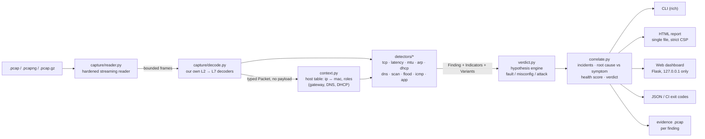

<div align="center">

# Faultline

### Is my network broken, or is someone breaking it?

**Faultline reads a packet capture, finds the faults *and* the attacks hidden in it, tells them apart, and explains every one in plain language: what happened, the likely cause, how to fix it, and the exact packets that prove it.**


**[Demo video](#demo-video)** · **[Try it in 60 seconds](#try-it-in-60-seconds)** · **[Proof](#proof-real-runs-not-mockups)** · **[See the output](#see-the-output)** · **[Every feature](#every-feature)** · **[Benchmark](#benchmark)** · **[Real-world validation](#real-world-validation)** · **[Security](#security)** · **[How we thought about it](#how-we-thought-about-it)**

*IIITDM Kancheepuram Cybersecurity Club · 24-hour hackathon · Network track: "Diagnosing Network Problems from Packet Captures"*
*Team **Moorthy Gang**: Yashvanth S (CS24I1029)*


</div>

---

## Results at a glance

| | |
|---|---|
| 🎯 **Detection** | **32 / 32** expected problems found across 37 labelled captures (`faultline bench`) |
| ⚖️ **Fault vs. attack** | **32 / 32** judged correctly: fault, misconfiguration or attack |
| 🔕 **False alarms** | **0**, and all 4 clean captures (including a busy 5,900-packet office) stay quiet |
| 🛡️ **Hostile input** | **6 / 6** malicious or broken files handled; **0 crashes** in 3,000 fuzzed captures (`scripts/fuzz.py`) |
| 🌍 **Real-world traffic** | **20 / 22** public Wireshark sample captures diagnosed correctly (real Nmap scans, Teardrop, a shell hidden on the DNS port, Telnet logins), **0 false alarms**, 0 crashes on 3 DNS-exploit files (`scripts/validate_public.py`) |
| 🧠 **Own logic** | 38 finding kinds, our own pcap/pcapng reader and L2→L7 decoders: **no Wireshark, tshark, Scapy or dpkt** |
| ✅ **Tested** | 339 automated tests passing on Python 3.10 and 3.12; secret scan clean |

Every number above is produced by a command in this repo and can be re-run in under a minute: see [Verify our claims](#verify-our-claims).

---

## Proof: real runs, not mockups

Every claim in this README can be checked. The screenshots below are **real macOS Terminal windows** captured while the commands ran. The terminal recordings next to them are the **live output** of each command, re-generated by [`scripts/make_proof.py`](scripts/make_proof.py) (run it yourself and you get the same output).

| The tool on an attack (real Terminal) | Test suite + benchmark (real Terminal) |
|---|---|
|  |  |
| **Fuzzing + secret scan (real Terminal)** | **Real-world captures from wiki.wireshark.org** |
|  |  |

<details>
<summary><b>More proof: every verification run, recorded live (click to expand)</b></summary>

| What it proves | Recording |
|---|---|
| 339 automated tests pass |  |
| Benchmark: 32/32 detected, 32/32 correct verdict, 0 false alarms |  |
| 3,000 corrupted captures through the whole pipeline: 0 crashes |  |
| Broken / hostile files give a one-line reason and exit code 2, never a traceback |  |
| `--redact` replaces every IP and MAC with a pseudonym |  |
| No secrets, no `eval` / `pickle` / shell calls in the code |  |

</details>

## The problem

A small office, a lab, a campus department. Nobody there is a network engineer. One morning "the internet is broken": pages go to the wrong place, video calls freeze, the printer vanishes. The office manager does the only thing they know: restart the router, wait, hope.

The honest way to find out what is wrong is to take a packet capture and read it, line by line, in Wireshark. That takes years of protocol knowledge, and it hides a nastier problem: **an outage and an attack look identical to the person suffering them.**

- Two devices fighting over one IP address and an attacker poisoning the ARP table both produce "the Wi-Fi keeps dropping".
- A dead DNS server and a DNS hijack both produce "websites don't work".

While the manager reboots the router, the attacker sitting on the LAN keeps reading the traffic.

## Our answer: diagnosis, not just detection

Faultline is built around the question nobody else answers first: **fault or attack?**

For every problem it finds, Faultline:

1. **Says what is wrong in plain language**, with an everyday analogy, for a beginner. An expert view sits one click away.
2. **Decides "fault", "misconfiguration" or "attack"**, and **shows its reasoning both ways**: the evidence for its verdict *and* why it rejected the alternative ("why this is ARP spoofing and **not** an IP conflict").
3. **Separates root causes from symptoms.** "A rogue DHCP server handed out a fake DNS server, so DNS answers were forged and a password leaked. **Fix the DHCP server first.**"
4. **Gives the likely cause and concrete fix steps**, with real commands (`ipconfig /renew`, `show mac address-table`, `ping -M do -s 1472`, …).
5. **Points to the exact packets** (Wireshark frame numbers and a ready-to-paste filter), plus a **one-click evidence `.pcap`** with just those packets.
6. **Gives one verdict for the whole capture**: `Healthy`, `Minor issues`, `Faulty` or `Under attack`, with a 0–100 health score.

## Try it in 60 seconds

```bash
git clone https://github.com/YashvanthSankar/faultline.git && cd faultline
python3 -m venv .venv && source .venv/bin/activate        # Windows: .venv\Scripts\activate
pip install -e .                                          # installs rich + flask and the `faultline` command

faultline analyze samples/mitm_chain.pcap                 # an attack: rogue DHCP → fake DNS → stolen password
faultline analyze samples/lossy_link.pcap                 # a fault: lossy Wi-Fi, no attack
faultline web                                             # dashboard at http://127.0.0.1:8765, click any sample
```

That's all. No Wireshark, no root, no internet connection, no API keys. Python ≥ 3.10 on macOS, Linux or Windows.

## See the output

All images below are **real output** generated from the bundled samples by [`scripts/make_assets.py`](scripts/make_assets.py); nothing is mocked. You can also open the full interactive reports in [`docs/examples/`](docs/examples) (download and open in a browser; they are single offline HTML files).

### Terminal: an attack, explained

`faultline analyze samples/mitm_chain.pcap`: three findings chained into one incident, each with "why we think it's an attack" and the evidence frames.


### Terminal: a fault, *not* an attack

`faultline analyze samples/lossy_link.pcap`: 5% packet loss, located relative to the capture point, with "no sign of an attack".


### Same symptom, opposite diagnosis

Both captures contain "two MAC addresses claim one IP". Faultline calls one a harmless **misconfiguration** and the other an **ARP-spoofing attack**, and says why.

| `ip_conflict.pcap`: printer and laptop share .23 | `arp_spoofing.pcap`: a device impersonates the router |
|---|---|
|  |  |

<!-- WEB_UI_SCREENSHOTS: regenerated from the new dashboard UI -->

## Demo video

<!-- VIDEO_LINK -->
🎬 **Demo video (2–5 min):** *link will be added here before submission.*

## How we thought about it

The full reasoning, with worked examples and the trade-offs we rejected, is in [`docs/THINKING.md`](docs/THINKING.md). The six ideas that shaped Faultline:

1. **Diagnosis, not detection.** An alert says *what* happened. A diagnosis says *why*, *how sure we are*, and *what to do first*. So every finding carries a cause, fix steps and evidence, and related findings are linked into one story with a root cause.
2. **An outage and an attack produce the same symptoms, so decide with evidence on both sides.** Detectors never label anything "attack" directly. They list evidence *for each* explanation (fault, misconfiguration, attack) with weights, and one shared engine picks the strongest and explains why the others lost. That is how the same "two MACs claim one IP" becomes a harmless conflict in one capture and ARP spoofing in another.
3. **False alarms destroy trust faster than misses.** A beginner who sees "ATTACK" on a healthy network stops believing the tool. So healthy look-alikes (isolated retransmissions, RST after FIN, typo NXDOMAINs, traceroute, ISP routers ARP-ing customers) are in the benchmark, and they **must stay silent**.
4. **Where you capture matters.** One capture point sees half of every story. Faultline uses that position: it tells loss *before* the capture point from loss *after* it, and splits round-trip time into the network side and the server side.
5. **A capture file is hostile input.** It may be truncated, malformed or crafted to crash the parser or inject script into the report. So we wrote our own bounds-checked reader and decoders, fuzz them, and treat every string from a packet as untrusted all the way to the HTML.
6. **Prove it, don't claim it.** A labelled scenario lab, a benchmark with a false-alarm count, real public captures with the misses shown, and screenshots of real runs. Our own testing found real bugs (two redaction leaks, an upload limit, an ISP-router false alarm) and every one was fixed with a regression test.

## Every feature

| Area | What Faultline does |
|---|---|
| **Input** | `.pcap` (µs / ns, either byte order), `.pcapng` (multi-section, multi-interface, any timestamp resolution), `.pcap.gz`; Ethernet, 802.1Q / QinQ VLANs, Linux SLL / SLL2, raw IP, BSD loopback |
| **Decoding (our own)** | ARP, IPv4 (+fragments), IPv6 (+extension headers), TCP (+MSS / window-scale / SACK / timestamps), UDP, ICMP / ICMPv6 (+quoted original packet), DNS (+safe name decompression), DHCP, TLS (SNI, versions, alerts), HTTP/1.x, clear-text logins (FTP, Telnet, POP3, IMAP, SMTP AUTH, HTTP Basic). About 320,000 packets/s |
| **Faults** | Packet loss with location (before or after the capture point), resets, refused connections, unanswered SYNs, zero windows, high latency, slow servers, DNS timeouts / errors / slowness / NXDOMAIN bursts, unanswered ARP, missing DHCP server, routing loops, unreachable hosts, broadcast storms, TLS failures, HTTP 5xx |
| **Misconfigurations** | IP conflicts, a second DHCP server, DHCP NAKs, MTU black holes, fragmentation-needed, refused services, expired / untrusted certificates, old TLS versions, passwords sent in clear text |
| **Attacks** (MITRE ATT&CK mapped) | ARP spoofing, rogue DHCP, DHCP starvation, DNS hijacking, DNS tunnelling, malware DGA lookups, port scans (SYN, connect, FIN / NULL / Xmas, UDP), host / ping / ARP sweeps, SYN / ICMP floods, Smurf, ping of death, ICMP redirects, Teardrop / tiny-fragment evasion, shells hidden on the DNS port, password brute force, web content scans, TCP RST injection |
| **Reasoning** | Fault / misconfiguration / attack hypothesis scoring with confidence and "why not the other one", root-cause ↔ symptom incident chains, a 0–100 health score, one overall verdict |
| **Explanations** | For every finding: plain-language summary, beginner explanation, everyday analogy, likely cause, numbered fix steps with real commands, and an expert technical paragraph |
| **Evidence** | Exact frame numbers (Wireshark numbering), a copy-ready Wireshark filter, evidence-packet table, a one-click evidence `.pcap` per finding, hosts and roles (gateway / DNS / DHCP), top talkers, conversations, timeline |
| **Interfaces** | Colour terminal UI, a self-contained interactive HTML report (beginner / expert toggle, filters, timeline, share summary, print view), a local web dashboard (drag-and-drop upload, sample gallery), and JSON output |
| **Automation** | `--json`, exit codes, `--fail-on attack\|fault\|any` for CI or scheduled checks, `faultline diff before after` to prove a fix worked |
| **Privacy and security** | `--redact` pseudonymisation, credentials never extracted, no payload stored, owner-only report files, strict CSP, XSS-proof rendering, CSRF / DNS-rebinding / upload hardening, size and decompression limits, no network calls, no secrets |
| **Quality** | 37-capture labelled lab (`faultline lab`), benchmark (`faultline bench`), real-world validation on public captures, 339 tests, fuzzer, secret scanner, reproducible proof screenshots |

## Why it's different

Wireshark shows packets. Intrusion detection systems raise alerts. Both leave the hard part, *interpretation*, to an expert. Faultline is a **diagnosis engine**.

| Capability | Wireshark expert info | Zeek | Suricata / Snort | **Faultline** |
|---|---|---|---|---|
| TCP faults (retransmissions, resets, zero window, MTU) | ✅ | partly (logs) | ❌ | ✅ |
| Attacks (scans, ARP/DNS/DHCP spoofing, floods) | ❌ | via scripts | ✅ signatures | ✅ behaviour-based |
| **Decides fault vs. attack, with "why not the other one"** | ❌ | ❌ | ❌ | ✅ competing hypotheses, counter-evidence shown |
| **Root cause vs. symptom ("fix this first")** | ❌ | ❌ | ❌ | ✅ incident chains |
| **Packet loss located before / after the capture point** | ❌ | ❌ | ❌ | ✅ |
| **"It's slow": network vs. server vs. receiver blame** | ❌ | ❌ | ❌ | ✅ |
| Plain-language explanation, analogy, cause and fix for every finding | ❌ | ❌ | ❌ | ✅ |
| Per-finding evidence `.pcap` + Wireshark filter | manual | ❌ | ❌ | ✅ one click |
| Shareable report with IPs/MACs pseudonymised | ❌ | ❌ | ❌ | ✅ `--redact` |
| Before/after comparison to prove a fix worked | ❌ | ❌ | ❌ | ✅ `faultline diff` |
| Ships its own labelled benchmark with a false-alarm rate | ❌ | ❌ | ❌ | ✅ `faultline bench` |

(Comparison refers to what each tool does out of the box for a non-expert.)

## Coverage of the brief

| Challenge point | How Faultline addresses it | Finding kinds |
|---|---|---|
| **Reading captures safely** | Own streaming reader for pcap / pcapng / `.pcap.gz`. Every length is checked against hard caps (record ≤ 256 KiB, block ≤ 16 MiB, 10 M packets, 4 GiB file, 2 GiB decompressed). Runs of empty records are capped. Corruption becomes a warning with the byte offset, and the analysis of everything read still completes. Payload bytes are never kept. Fuzz-tested. | reader warnings, `capture.malformed` |
| **TCP retransmissions and resets** | Per-flow state tracker covering retransmissions (fast / timeout / spurious), dup-ACKs, gaps, aborts, refused connections, unanswered SYNs and zero windows, plus **loss localisation** (before or after the capture point) | `tcp.retransmissions`, `tcp.resets`, `tcp.refused`, `tcp.syn_timeout`, `tcp.zero_window` |
| **DNS failures** | Query ↔ response matching per transaction: timeouts (with per-server "stopped answering at…"), SERVFAIL/REFUSED, slow resolvers, NXDOMAIN bursts (typo vs. malware DGA) | `dns.timeout`, `dns.errors`, `dns.slow`, `dns.nxdomain` |
| **Duplicate IPs / ARP conflicts** | Every ARP claim per IP, who answered when asked, probes (RFC 5227), flip-flops; conflict vs. spoofing decided by weighted evidence | `arp.duplicate_ip`, `arp.unanswered`, `arp.storm` |
| **MTU mismatches** | ICMP fragmentation-needed / packet-too-big with "did the sender adapt?", plus **PMTUD black holes** (large DF segments resent with no ICMP while small ones pass) with a path-MTU estimate | `mtu.frag_needed`, `mtu.blackhole` |
| **Unusual delays** | Handshake RTT split at the capture point, server think time, client-side delay: "the network is fine, the server is slow" | `latency.high_rtt`, `latency.slow_server` |
| **Port scans** | SYN half-open, connect, FIN/NULL/Xmas, UDP scans; host, ping and ARP sweeps | `scan.port`, `scan.host_sweep`, `arp.scan` |
| **ARP spoofing** | Gateway impersonation, unsolicited replies on a rhythm, one MAC claiming many IPs, traffic redirected to the impostor (MITRE T1557.002) | `arp.duplicate_ip` (attack reading) |
| **DNS hijacking** | Two different answers to one query (race), answers that arrive faster than physically possible, answers from servers never asked, public names → LAN address of a rogue host; tunnelling (MITRE T1557, T1071.004) | `dns.hijack`, `dns.tunneling` |
| **Rogue DHCP servers** | Rogue (same subnet, names itself router/DNS, wins the race) vs. misplugged home router (different subnet, public DNS); no server; NAKs; starvation (MITRE T1557.003) | `dhcp.multiple_servers`, `dhcp.no_server`, `dhcp.nak`, `dhcp.starvation` |
| **Telling an outage from an attack** | Hypothesis engine over weighted indicators + correlation into incidents; `outage_vs_attack_mixed.pcap` contains both and they are reported separately | all; [`verdict.py`](faultline/verdict.py), [`correlate.py`](faultline/correlate.py) |
| **Keeping false alarms low** | Precision-first thresholds; clean and busy captures are part of the benchmark and must stay silent; `--sensitivity low/normal/high` | [`bench.py`](faultline/bench.py) |
| **Explaining clearly** | Every finding has a summary, beginner explanation, analogy and an expert "technical" paragraph | all |
| **Recommending fixes** | Every finding has a likely cause and ordered fix steps; incidents add "Do this first" | all |
| **Showing the evidence** | Exact frame numbers, Wireshark filter, evidence-line table, timeline with finding bands, hosts and conversations, downloadable evidence `.pcap` | all |
| *Beyond the brief* | Floods, ICMP diagnostics, TLS and HTTP problems, passwords sent in clear text, backdoors on the DNS port, fragmentation attacks, damaged captures | `dns.non_dns_traffic`, `ip.fragment_attack`, `flood.syn`, `flood.icmp`, `flood.broadcast`, `icmp.unreachable`, `icmp.routing_loop`, `icmp.redirect`, `tls.failure`, `tls.deprecated`, `http.errors`, `cred.cleartext`, `capture.malformed` |

The full catalogue with signals, thresholds and discriminators is in [`docs/DETECTORS.md`](docs/DETECTORS.md).

## How it works



**One streaming pass.** The reader yields one frame at a time. The decoder turns each frame into a compact `Packet` holding header fields only, never payload bytes. The host table and every detector see each packet once. Memory stays bounded: flow and host tables evict their oldest entries, and evidence keeps ≤ 200 frame numbers per finding. A second, targeted pass re-reads only the evidence frames to build the evidence table and evidence pcaps.

**The hypothesis engine.** Detectors never decide "attack". They report what they saw as `Indicator(text, supports, weight)`, where `supports ∈ {fault, misconfig, attack}` and the weight runs from 0.5 (hint) to 3 (near-conclusive). They also supply a `Variant` (title, explanation, cause, fix, MITRE technique) for each plausible reading. [`verdict.py`](faultline/verdict.py) then decides the same way for every detector:
- it scores each hypothesis as the sum of its indicator weights, plus a 0.5 prior for the detector's own reading;
- it picks the highest score and turns the margin into a confidence (softmax, clamped to 50–99%);
- it keeps the losing hypotheses together with their evidence, which become the "why not" text.

**Worked example: "two MAC addresses claim one IP"** (real indicator texts and weights from [`detectors/arp.py`](faultline/detectors/arp.py), real scores from the samples):

| Evidence seen | Supports | Weight | `arp_spoofing.pcap` | `ip_conflict.pcap` |
|---|---|---|:---:|:---:|
| The suspicious MAC answered ARP for 2 different IPs that belong to other devices | attack | 2.5 | ✔ | |
| The disputed address belongs to the router (default gateway) | attack | 2.0 | ✔ | |
| The suspicious MAC sent 149 ARP replies nobody asked for | attack | 2.0 | ✔ | |
| 87 packets meant for internet addresses were sent to the suspicious MAC instead of the router | attack | 2.0 | ✔ | |
| Replies repeat like clockwork (~1.6 s), typical of a poisoning tool | attack | 1.0 | ✔ | |
| The original owner flipped between the two MACs while the original stayed active | attack | 1.0 | ✔ | |
| A device probed the address before using it (RFC 5227), normal boot behaviour | misconfig | 1.5 | | ✔ |
| Both MACs send their own normal traffic from that address | misconfig | 1.5 | | ✔ |
| The disputed address is not the router's | misconfig | 1.0 | | ✔ |
| The suspicious MAC only answered when asked; claims only this one address | misconfig | 1.0 + 1.0 | | ✔ |
| Both MACs answered the same ARP question | misconfig | 1.0 | ✔ | ✔ |
| **Result** | | | **attack 13.0 vs misconfig 1.0** → *"Someone is impersonating the router (ARP spoofing)"*, 99%, MITRE T1557.002 | **misconfig 8.0 vs attack 0.0** → *"Two devices are using the same IP address"*, 99% |

The report shows both columns: why it *is* the winning reading, and why it is *not* the other one.

**Correlation.** [`correlate.py`](faultline/correlate.py) links related findings into incidents using chain rules. Examples:
- rogue DHCP / ARP spoofing / ICMP redirect + DNS hijack + leaked password → *man-in-the-middle attack*;
- no DHCP server → the DNS and TCP failures that follow are symptoms;
- a port scan → the resets and ICMP errors it triggers are side effects, not separate problems;
- an MTU black hole → the retransmissions it causes.

Symptoms are listed under their root cause, so a beginner sees one thing to fix first. The health score is 100 minus a penalty per finding, scaled by severity and confidence; symptoms count at 40%.

More on the reasoning, trade-offs and what we rejected: [`docs/THINKING.md`](docs/THINKING.md).

## Usage

```bash
faultline analyze CAPTURE [options]     # .pcap, .pcapng, .cap, .pcap.gz
faultline web [--host 127.0.0.1] [--port 8765] [--no-browser]
faultline diff BEFORE.pcap AFTER.pcap   # did the fix work?
faultline lab [samples/]                # regenerate the labelled sample captures (deterministic)
faultline bench [samples/]              # accuracy + false-alarm benchmark on the labelled samples
python -m faultline …                   # same, without installing the console script
```

| `analyze` option | What it does |
|---|---|
| `--html FILE` | Single-file interactive HTML report (offline, no external resources, strict CSP). File created with mode 0600 |
| `--json FILE` | Full machine-readable report (`-` for stdout) |
| `--evidence-dir DIR` | One small evidence `.pcap` per finding, e.g. `f1-dhcp.multiple_servers.pcap` |
| `--redact` | Replace every IP and MAC with a consistent pseudonym (HMAC-SHA256, random key per run, never stored). Evidence pcaps are disabled in this mode |
| `--sensitivity low\|normal\|high` | Scale detection thresholds (×1.6 / ×1.0 / ×0.6) |
| `--expert` | Technical paragraph, all indicators, info-level notes, host table |
| `--fail-on attack\|fault\|any` | Exit code 1 if such findings (severity ≥ medium) exist, for CI / scheduled checks |
| `--quiet`, `--no-color`, `--max-packets N`, `--no-evidence` | Quieter / bounded runs (`NO_COLOR` is honoured) |

Exit codes: `0` analysed · `1` `--fail-on` condition met · `2` unusable input (with a one-line reason).

**Web dashboard.** `faultline web` opens a local page. You can drag and drop a capture, or click any bundled sample in the gallery; each sample carries its scenario story and expected verdict. Options include redaction and sensitivity. The report it renders is the same file `--html` writes, and you can download it from there.

## Sample captures

All 37 samples were **synthesised by our own scenario lab**, byte by byte, with correct checksums (validated against `tcpdump`). Labels are in [`samples/labels.json`](samples/labels.json). They contain no real user data, and `faultline lab` regenerates the exact same bytes. Every scenario hides its problem inside realistic background traffic (DNS, HTTPS with SNI, ARP, NTP, DHCP).

| Category | Captures |
|---|---|
| **Healthy** (must stay quiet) | `clean_office.pcap`, `busy_but_healthy.pcap` (5,900 packets with benign look-alikes: isolated retransmissions, RST after FIN, a typo NXDOMAIN, traceroute, parallel connections), `pcapng_office.pcapng`, `xss_payload.pcap` |
| **Faults** | `lossy_link`, `server_down_timeouts`, `zero_window`, `slow_server`, `high_latency`, `dns_failure`, `dhcp_no_server`, `routing_loop` |
| **Misconfigurations** | `connection_refused`, `mtu_blackhole`, `mtu_frag_needed`, `ip_conflict`, `dhcp_misconfig_two_routers`, `cleartext_creds`, `tls_failures` |
| **Attacks** | `arp_spoofing`, `port_scan`, `host_sweep`, `dns_hijack`, `rogue_dhcp`, `syn_flood`, `dns_tunnel`, `web_bruteforce`, `dns_backdoor` (shell on port 53), `teardrop`, **`mitm_chain`** (rogue DHCP → fake DNS → stolen login) |
| **Fault + attack together** | `outage_vs_attack_mixed.pcap`: a DNS outage *and* an unrelated port scan, reported separately |
| **Hostile files** | `malformed/truncated.pcap`, `bad_magic.pcap`, `huge_caplen.pcap`, `zero_length.pcap`, `corrupt_packets.pcap`, `compressed_padding.pcap.gz` (50 MB of padding behind a 51 KB gzip) |

## Benchmark

`faultline bench` runs every labelled capture through the full engine. It checks that each expected problem is **detected**, that it got the **right verdict** (fault / misconfig / attack), that **nothing unexpected** of medium or higher severity was raised, and that hostile files never crash the tool. This table is that command's output, converted to Markdown:

| Capture | Expected finding(s) | Detected | Correct verdict | False alarms | Result |
|---|---|---|---|---|---|
| `arp_spoofing.pcap` | `arp.duplicate_ip` (attack) | 1/1 | 1/1 | 0 | ✅ pass |
| `busy_but_healthy.pcap` | *clean: must stay quiet* | 0/0 | - | 0 | ✅ pass |
| `clean_office.pcap` | *clean: must stay quiet* | 0/0 | - | 0 | ✅ pass |
| `cleartext_creds.pcap` | `cred.cleartext` (misconfig) | 1/1 | 1/1 | 0 | ✅ pass |
| `connection_refused.pcap` | `tcp.refused` (misconfig) | 1/1 | 1/1 | 0 | ✅ pass |
| `dhcp_misconfig_two_routers.pcap` | `dhcp.multiple_servers` (misconfig) | 1/1 | 1/1 | 0 | ✅ pass |
| `dhcp_no_server.pcap` | `dhcp.no_server` (fault) | 1/1 | 1/1 | 0 | ✅ pass |
| `dns_backdoor.pcap` | `dns.non_dns_traffic` (attack) | 1/1 | 1/1 | 0 | ✅ pass |
| `dns_failure.pcap` | `dns.timeout` (fault), `dns.errors` (fault) | 2/2 | 2/2 | 0 | ✅ pass |
| `dns_hijack.pcap` | `dns.hijack` (attack) | 1/1 | 1/1 | 0 | ✅ pass |
| `dns_tunnel.pcap` | `dns.tunneling` (attack) | 1/1 | 1/1 | 0 | ✅ pass |
| `high_latency.pcap` | `latency.high_rtt` (fault) | 1/1 | 1/1 | 0 | ✅ pass |
| `host_sweep.pcap` | `arp.scan` (attack) | 1/1 | 1/1 | 0 | ✅ pass |
| `ip_conflict.pcap` | `arp.duplicate_ip` (misconfig) | 1/1 | 1/1 | 0 | ✅ pass |
| `lossy_link.pcap` | `tcp.retransmissions` (fault) | 1/1 | 1/1 | 0 | ✅ pass |
| `malformed/bad_magic.pcap` | *hostile file: must not crash* | handled | - | 0 | ✅ pass |
| `malformed/compressed_padding.pcap.gz` | *hostile file: must not crash* | handled | - | 0 | ✅ pass |
| `malformed/corrupt_packets.pcap` | *hostile file: must not crash* | handled | - | 0 | ✅ pass |
| `malformed/huge_caplen.pcap` | *hostile file: must not crash* | handled | - | 0 | ✅ pass |
| `malformed/truncated.pcap` | *hostile file: must not crash* | handled | - | 0 | ✅ pass |
| `malformed/zero_length.pcap` | *hostile file: must not crash* | handled | - | 0 | ✅ pass |
| `mitm_chain.pcap` | `dhcp.multiple_servers` (attack), `dns.hijack` (attack), `cred.cleartext` (misconfig) | 3/3 | 3/3 | 0 | ✅ pass |
| `mtu_blackhole.pcap` | `mtu.blackhole` (misconfig) | 1/1 | 1/1 | 0 | ✅ pass |
| `mtu_frag_needed.pcap` | `mtu.frag_needed` (misconfig) | 1/1 | 1/1 | 0 | ✅ pass |
| `outage_vs_attack_mixed.pcap` | `dns.timeout` (fault), `scan.port` (attack) | 2/2 | 2/2 | 0 | ✅ pass |
| `pcapng_office.pcapng` | *clean: must stay quiet* | 0/0 | - | 0 | ✅ pass |
| `port_scan.pcap` | `scan.port` (attack) | 1/1 | 1/1 | 0 | ✅ pass |
| `rogue_dhcp.pcap` | `dhcp.multiple_servers` (attack) | 1/1 | 1/1 | 0 | ✅ pass |
| `routing_loop.pcap` | `icmp.routing_loop` (fault) | 1/1 | 1/1 | 0 | ✅ pass |
| `server_down_timeouts.pcap` | `tcp.syn_timeout` (fault), `arp.unanswered` (fault) | 2/2 | 2/2 | 0 | ✅ pass |
| `slow_server.pcap` | `latency.slow_server` (fault) | 1/1 | 1/1 | 0 | ✅ pass |
| `syn_flood.pcap` | `flood.syn` (attack) | 1/1 | 1/1 | 0 | ✅ pass |
| `teardrop.pcap` | `ip.fragment_attack` (attack) | 1/1 | 1/1 | 0 | ✅ pass |
| `tls_failures.pcap` | `tls.failure` (misconfig) | 1/1 | 1/1 | 0 | ✅ pass |
| `web_bruteforce.pcap` | `http.errors` (attack) | 1/1 | 1/1 | 0 | ✅ pass |
| `xss_payload.pcap` | *clean: must stay quiet* | 0/0 | - | 0 | ✅ pass |
| `zero_window.pcap` | `tcp.zero_window` (fault) | 1/1 | 1/1 | 0 | ✅ pass |

**Summary:** detection **32/32 (100%)** · correct fault/attack verdict **32/32 (100%)** · false alarms **0** · clean captures quiet **4/4** · hostile files handled **6/6** · 52,478 packets in about 1.5 s.

*Honesty note:* these scenarios come from our own lab, so the benchmark proves the detectors behave as designed and stay quiet on healthy look-alikes; it is not a claim about every real network. The unit tests (339 in total) also cover edge cases that are not in the samples.

## Real-world validation

Our benchmark uses captures we generated, so we also ran Faultline on **real traffic recorded by other people**: public sample captures from the Wireshark project. [`scripts/validate_public.py`](scripts/validate_public.py) downloads them, checks each against a pinned SHA-256, runs the full engine and scores the result. The captures are not redistributed here.

| Public capture | What it really contains | Faultline | Result |
|---|---|---|---|
| `nmap_standard_scan`, `nmap_OS_scan`, `nmap_OS_scan_succesful` | Real Nmap scans | `scan.port`: attack | ✅ |
| `nmap_ACK_scan_on_port_80_2` | Nmap with `-f` tiny fragments and a spoofed source | `ip.fragment_attack`: tiny fragments used to evade firewalls | ✅ |
| `teardrop.cap` | Teardrop overlapping-fragment attack | `ip.fragment_attack`: Teardrop-style attack | ✅ |
| `dns-remoteshell.pcap` | A Windows command shell running over TCP port 53 | `dns.non_dns_traffic`: *"A remote shell is hiding on the DNS port"* (critical) | ✅ |
| `telnet-raw.pcap`, `telnet-cooked.pcap`, `tcp-ecn-sample.pcap` | Telnet logins; router admin page with HTTP Basic auth | `cred.cleartext`: passwords sent in clear text | ✅ |
| `arp-storm.pcap` | ISP routers ARP-ing hundreds of customers | **no attack** (minor notes only) | ✅ no false alarm |
| `dns.cap`, `http.cap`, `dhcp.pcap`, `dhcp-and-dyndns`, `v6.pcap`, `ipv4frags.pcap`, `nfs_bad_stalls.cap` | Ordinary traffic (up to 7,000 packets) | healthy | ✅ no false alarm |
| `zlip-1/2/3.pcap` | DNS decompression **exploits** (hostile input) | parsed safely, no crash | ✅ |
| `nmap_ACK_scan_on_port_80` | A 6-packet ACK probe of one port | not detected | ⚠️ known limitation |
| `nmap_zombie_scan` | Idle/zombie scan (stealthy by design) | not detected | ⚠️ known limitation |

**20 of 22 correct, 0 false alarms, 0 crashes.** This testing also improved the tool. The first run found a false alarm on the ISP-router capture and two attacks we didn't cover yet (Teardrop, and a shell on the DNS port). All three were fixed and added to the lab and the tests.

## Security

Capture files are treated as **hostile input**, from the first byte read to the last pixel rendered. Full threat model: [`SECURITY.md`](SECURITY.md).

- **Reader:**
  - formats and versions are validated;
  - every length is checked against what's actually there and against hard caps;
  - gzip is streamed through a decompression-bomb guard;
  - runs of empty records are capped;
  - a corrupt file ends in a warning with a byte offset, never a traceback (exit code 2 for unusable files).
- **Decoders:**
  - every field read is bounds-checked;
  - DNS name decompression rejects pointer loops and forward jumps;
  - option and TLV loops have iteration caps;
  - a damaged packet is flagged and skipped, never raised.
- **Fuzzing:**
  - `scripts/fuzz.py` mutates valid captures (bit flips, length inflation, truncation, insertion, …) and runs the whole pipeline: **0 crashes in 3,000 cases**, slowest case under 20 ms;
  - [`tests/test_fuzz.py`](tests/test_fuzz.py) runs this in the test suite.
- **No data leaks:**
  - payload bytes are never stored;
  - passwords in clear-text protocols are *detected* but never extracted, stored or shown (only "FTP" / "HTTP Basic" / …);
  - `--redact` pseudonymises every IP and MAC in every field (verified across all samples), with a random key per run;
  - report files are created owner-readable only (0600).
- **Report XSS-proof:**
  - all text from packets is untrusted;
  - data is embedded as escaped JSON and rendered with `textContent` only;
  - a strict Content-Security-Policy pins the one script and one style by SHA-256;
  - no external resources.
  - `samples/xss_payload.pcap` carries `<script>` and `onerror=` payloads in DNS, DHCP, HTTP and TLS fields, and they render as plain text.
- **Web dashboard:**
  - binds to 127.0.0.1 and rejects foreign `Host` headers (DNS-rebinding guard);
  - CSRF token on uploads;
  - upload size cap, plus extension *and* magic-byte checks;
  - uploads go to a random 0600 temp file that is deleted after analysis, and reports are never stored;
  - security headers (CSP, `nosniff`, `X-Frame-Options: DENY`, `no-referrer`, `no-store`);
  - generic error pages;
  - at most 2 analyses at a time.
- **No secrets, no network:**
  - no API keys, no telemetry, no outbound connections, no `eval` / `pickle` / shell calls;
  - `scripts/check_secrets.py` scans the repo: **0 findings**.

## Verify our claims

```bash
pip install -e ".[dev]"                     # adds pytest
pytest -q                                   # 339 tests: reader, decoder, every detector, verdict, correlation, report, web, redaction, fuzz
faultline bench                             # the benchmark table above
python scripts/fuzz.py -n 3000 --seed 42    # hostile-input fuzzing: expect "RESULT: PASS - no crash, bounded time"
python scripts/check_secrets.py             # expect "0 potential secret(s) found: PASS"
python scripts/validate_public.py           # real-world check on public Wireshark captures (downloads ~1.5 MB, SHA-256 pinned)
python scripts/make_proof.py                # re-records every proof screenshot in docs/proof/ from live runs
python scripts/make_assets.py --shots       # regenerates every image in this README from the samples (needs Chrome for the PNGs)
```

## Project structure

```
faultline/
  capture/reader.py     hardened streaming pcap / pcapng / gzip reader
  capture/decode.py     Ethernet/VLAN/SLL/Raw/Null → ARP, IPv4/6, TCP (+options), UDP, ICMP/v6, DNS, DHCP, TLS, HTTP, cleartext auth
  capture/writer.py     pcap / pcapng writer (evidence export, lab)
  model.py              Packet (slots), Finding, Indicator, Variant, Severity, Category, Incident
  context.py            AnalysisContext, host table (ip↔mac, gateway / DNS / DHCP roles), sensitivity
  detectors/            base.py + tcp, latency, mtu, arp, dhcp, dns, scan, flood, icmp, app, protocol (38 finding kinds)
  verdict.py            hypothesis engine: fault / misconfig / attack + "why not"
  correlate.py          incidents, root cause vs symptom, health score, overall verdict
  engine.py             analyze(path, options) → Report (2 passes: analysis, evidence)
  report/               html.py (single-file report, CSP), assets/, redact.py
  web/                  Flask dashboard (upload, sample gallery, CSRF, security headers)
  lab/                  craft.py (byte-level packet builder), scenarios.py + scenarios_attack.py (labelled captures)
  bench.py · diff.py · cli.py
samples/                37 labelled captures + labels.json (+ malformed/)
tests/                  339 pytest tests (factory.py builds decoded packets for detector unit tests)
scripts/                fuzz.py · check_secrets.py · validate_public.py · make_assets.py · make_proof.py
docs/                   THINKING.md · DETECTORS.md · demo-script.md · images/ · examples/ · proof/
SECURITY.md · LICENSE · pyproject.toml · requirements.txt
```

About 22,400 lines of Python written during the hackathon.

## Libraries used

The brief asks for every library to be listed. **The analysis engine (reader, decoders, detectors, verdict, correlation) uses only the Python standard library:** `struct`, `socket`, `ipaddress`, `gzip`, `zlib`, `io`, `os`, `stat`, `hashlib`, `base64`, `collections`, `dataclasses`, `enum`, `functools`, `math`, `statistics`, `array`, `random`, `time`, `datetime`, `typing`, `importlib`. The report, web and tooling layers additionally use `json`, `html`, `hmac`, `secrets`, `re`, `tempfile`, `threading`, `argparse`, `unicodedata` and `urllib`.

Third-party open-source libraries, used **only for presentation and testing**:

| Library | License | Used for |
|---|---|---|
| [rich](https://github.com/Textualize/rich) | MIT | Coloured terminal output of the CLI |
| [Flask](https://github.com/pallets/flask) (+ its dependencies Werkzeug, Jinja2, MarkupSafe, itsdangerous, click, blinker) | BSD-3 / MIT | Local web dashboard |
| [pytest](https://github.com/pytest-dev/pytest) | MIT | Tests (development only) |

**Not used:** Wireshark, tshark, pyshark, Scapy, dpkt, Zeek, Suricata, any AI or cloud API, any network service. Parsing, decoding, detection and diagnosis are original code.

## Responsible use

Faultline is a defensive diagnostic tool. Only analyse captures from networks you own or are authorised to examine. Passwords sent in clear text are reported by protocol only, never extracted. Use `--redact` before sharing a report. The scenario lab writes synthetic packets into files; it never transmits anything.

## Limitations and future work

- **Encrypted content is opaque.** Faultline reads TLS handshakes (versions, SNI, cleartext alerts), never encrypted payloads.
- **One capture point assumed.** Loss localisation and RTT blame reason about a single vantage point; merged multi-point captures will confuse them.
- **Heuristic thresholds.** They are tuned for precision on our lab and on healthy look-alike traffic. `--sensitivity` adjusts them, but real networks vary.
- **Stealth scans.** A single-port ACK probe and an idle/zombie scan (both in the public Nmap samples) go undetected. The first looks like mid-connection traffic; the second hides the real scanner behind a third host.
- **Files, not live traffic.** Faultline analyses capture files; live capture was left out to spend the hours on diagnosis quality.
- **Protocol breadth.** Next steps: IPv6 neighbour-discovery spoofing, DHCPv6, QUIC, SMB, baselines learned from a known-good capture, and a plug-in API for third-party detectors.

## Team

**Moorthy Gang**: Yashvanth S (CS24I1029), team leader (solo team).
IIITDM Kancheepuram Cybersecurity Club 24-hour hackathon, Network track, 31 Oct – 1 Nov 2026.

## License

MIT, see [`LICENSE`](LICENSE).
