# Faultline

Faultline is an offline tool that reads a packet capture and answers one question for people who are not network engineers: **is the network broken, or is someone breaking it?** For every problem it finds, it states whether it is a fault, a misconfiguration or an attack, explains why in plain language, gives the likely cause and the fix, and points to the exact packets behind the conclusion.

Built for the IIITDM Kancheepuram Cybersecurity Club 24-hour hackathon, Network track ("Diagnosing Network Problems from Packet Captures"), by team **Moorthy Gang**: Yashvanth S (CS24I1029).

[Quick start](#quick-start) · [Example output](#example-output) · [Demo video](#demo-video) · [Design](#design) · [Why no AI](#why-faultline-does-not-use-ai-or-machine-learning) · [How it works](#how-it-works) · [Evaluation](#evaluation) · [Security](#security) · [Limitations](#limitations)

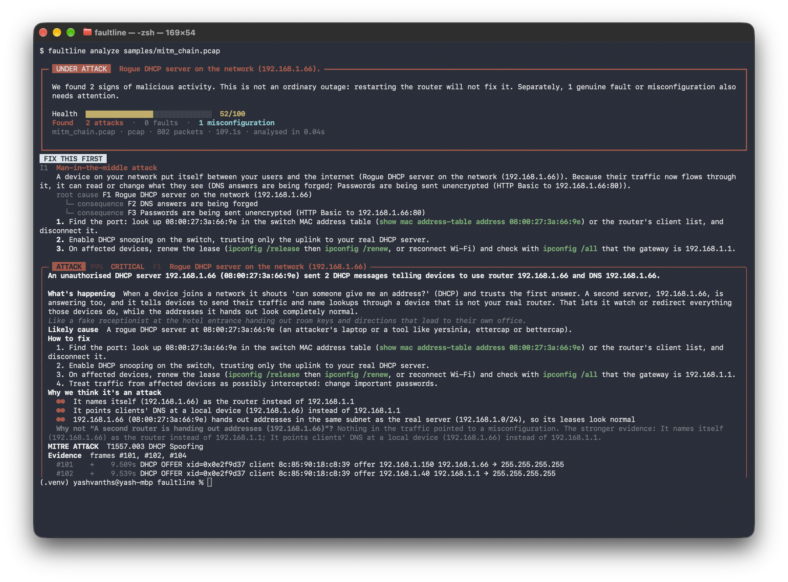

## Overview

In a small office or a lab, network trouble usually reaches someone as "the internet is broken". Finding the cause means reading a packet capture in Wireshark, which takes protocol knowledge most people don't have. There is a second difficulty: a fault and an attack often look the same from the user's chair. Two devices sharing one IP address and an attacker poisoning ARP tables both feel like an unreliable connection. A dead DNS server and a hijacked one both feel like websites not working.

Faultline treats this as a diagnosis problem rather than an alerting problem:

- Each finding is classified as a **fault**, a **misconfiguration** or an **attack**. The tool shows the evidence for that conclusion and the evidence that pointed elsewhere.
- Related findings are linked into incidents so that the root cause is fixed first, for example "a rogue DHCP server handed out a fake DNS server, which is why DNS answers were forged".
- Every finding has a beginner explanation, an expert explanation, a likely cause, ordered fix steps with real commands, Wireshark frame numbers, and a downloadable evidence capture.
- The capture as a whole gets one verdict (healthy, minor issues, faulty, under attack) and a 0–100 health score.

## Results

| Measure | Result | How to reproduce |
|---|---|---|
| Labelled benchmark: expected problems detected | 32 of 32, across 37 captures | `faultline bench` |
| Labelled benchmark: correct fault / misconfiguration / attack verdict | 32 of 32 | `faultline bench` |
| False alarms on the benchmark | 0 (including a 5,900-packet busy office capture with benign look-alikes) | `faultline bench` |
| Public real-world captures (wiki.wireshark.org) diagnosed correctly | 20 of 22, no false alarms; the two misses are stealth scans, listed under [Limitations](#limitations) | `python scripts/validate_public.py` |
| Hostile or corrupted input | 6 of 6 malformed sample files handled; 0 crashes in 3,000 fuzzed captures | `python scripts/fuzz.py -n 3000 --seed 42` |
| Automated tests | 357 passing on Python 3.10 and 3.12 | `pytest -q` |

The labelled benchmark uses captures produced by our own scenario lab, so it shows that the detectors behave as designed. The public captures are the independent check.

## Quick start

Requires Python 3.10 or newer. Works on macOS, Linux and Windows. No root, network access, Wireshark or API keys needed.

```bash
git clone https://github.com/YashvanthSankar/faultline.git && cd faultline
python3 -m venv .venv && source .venv/bin/activate      # Windows: .venv\Scripts\activate
pip install -e .

faultline analyze samples/mitm_chain.pcap               # an attack: rogue DHCP, forged DNS, leaked password
faultline analyze samples/lossy_link.pcap               # a fault: packet loss, no attack
faultline analyze samples/mitm_chain.pcap --html report.html
faultline web                                           # local dashboard at http://127.0.0.1:8765
```

## Example output

All images below are generated from the bundled samples by [`scripts/make_assets.py`](scripts/make_assets.py) and [`scripts/make_proof.py`](scripts/make_proof.py). Re-running those scripts reproduces them.

**An attack.** `faultline analyze samples/mitm_chain.pcap`: three findings linked into one incident, with the reasoning and the evidence frames.

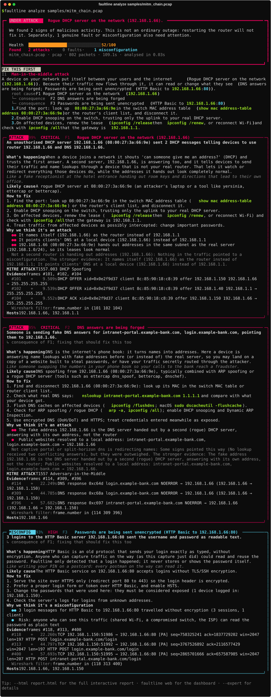

**A fault, not an attack.** `faultline analyze samples/lossy_link.pcap`: 5% packet loss, located relative to the capture point.

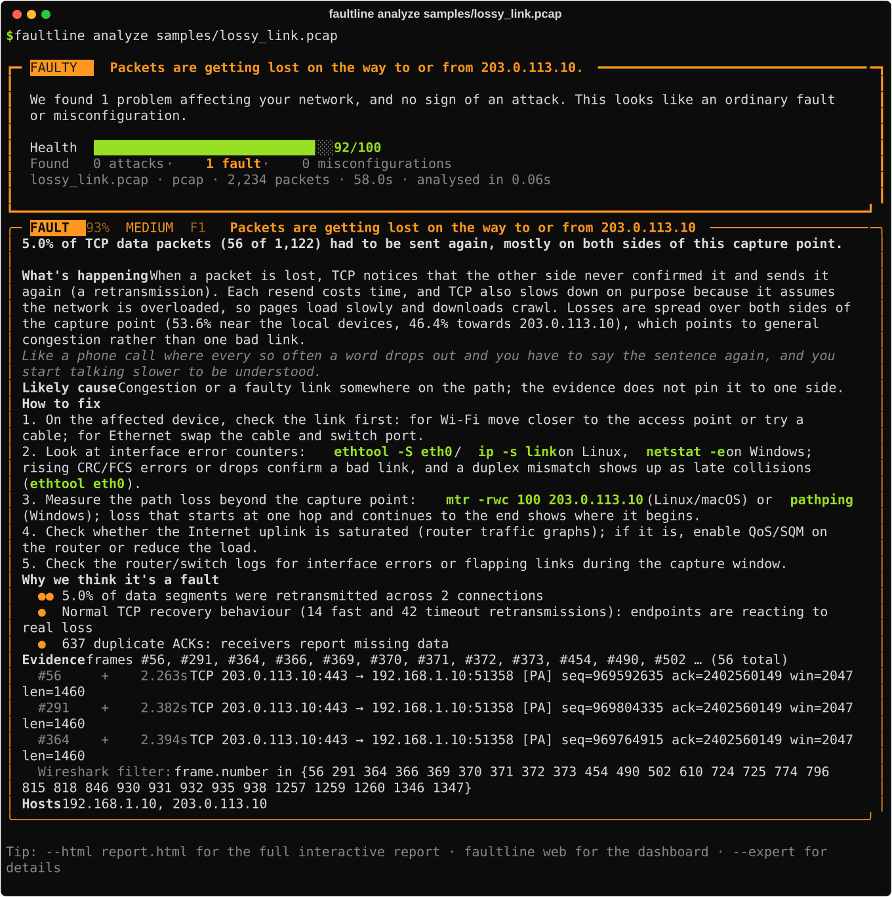

**Same symptom, different diagnosis.** In both captures two MAC addresses claim one IP address. Faultline reports the first as a misconfiguration (a printer and a laptop configured with the same address) and the second as ARP spoofing of the router.

| `ip_conflict.pcap` | `arp_spoofing.pcap` |
|---|---|
| 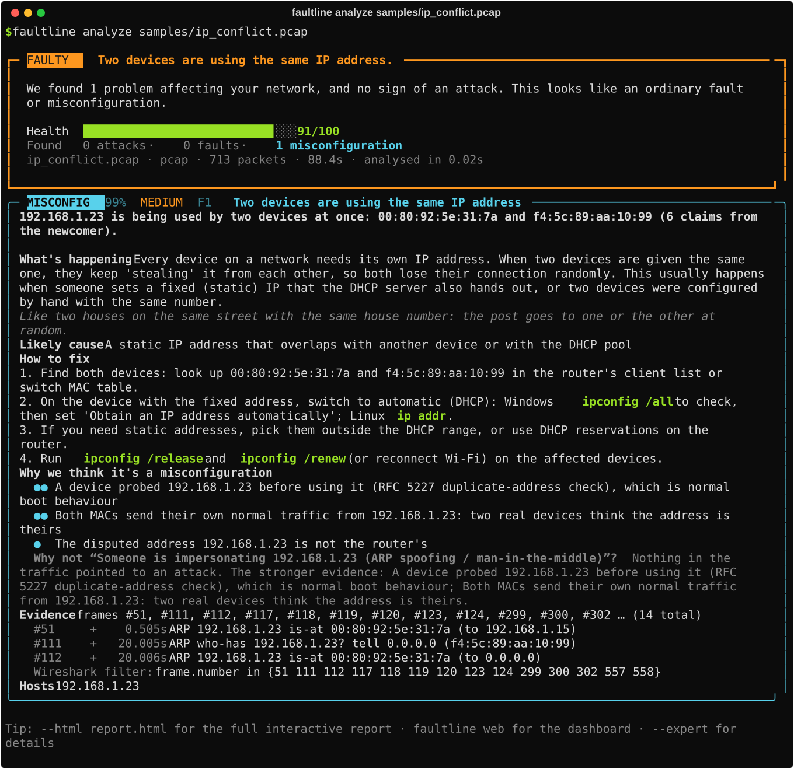 | 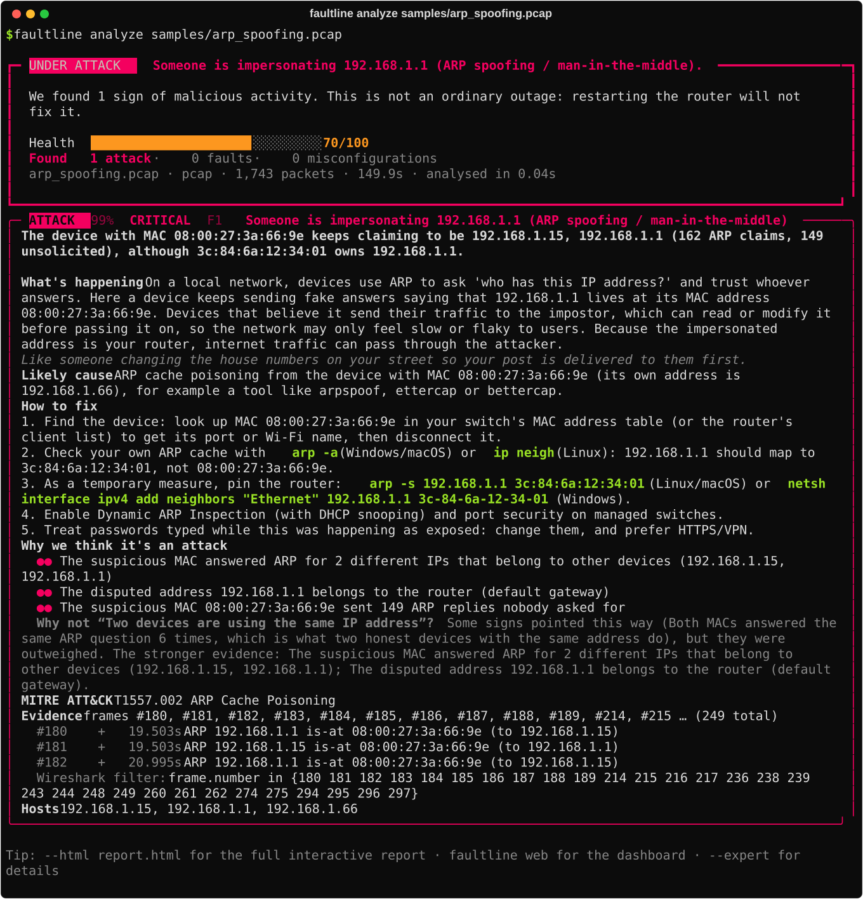 |

**Web dashboard and HTML report.** `faultline web` serves the same analysis as an interactive report; `--html` writes it as a single offline file. Screenshots are taken from the running dashboard by [`scripts/make_web_shots.py`](scripts/make_web_shots.py).

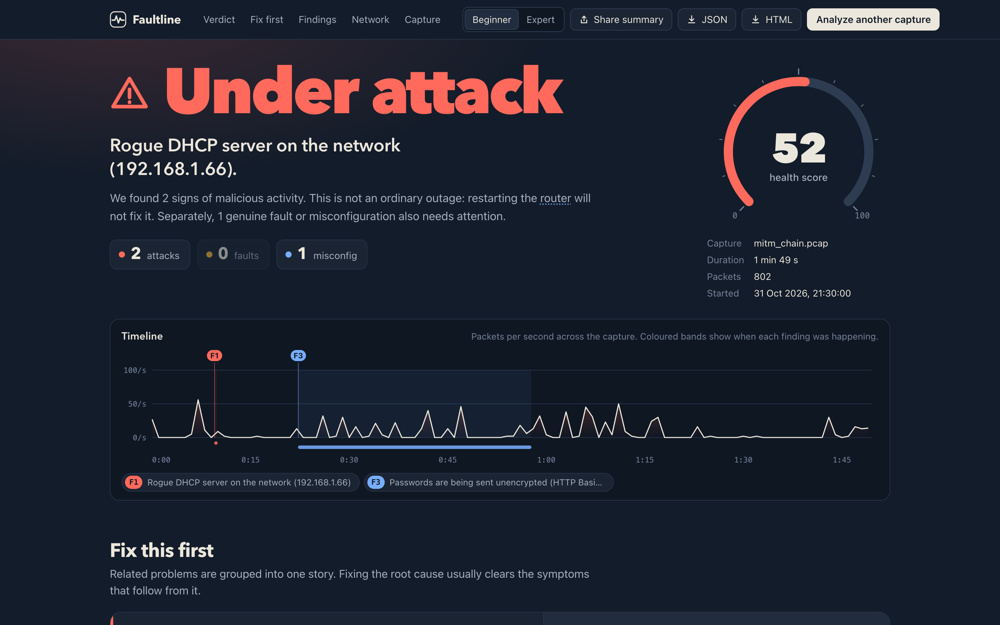

The reasoning behind a verdict is shown for every finding. For `arp_spoofing.pcap`, the attack explanation scores 13.0 against 1.0 for a misconfiguration; each piece of evidence is listed with its weight, followed by why the alternative was rejected:

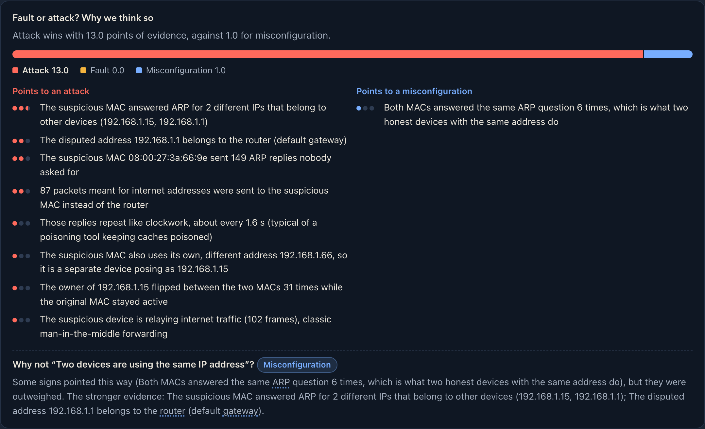

| Network map: the rogue device (.66) next to the real router | Two captures compared side by side |
|---|---|
| 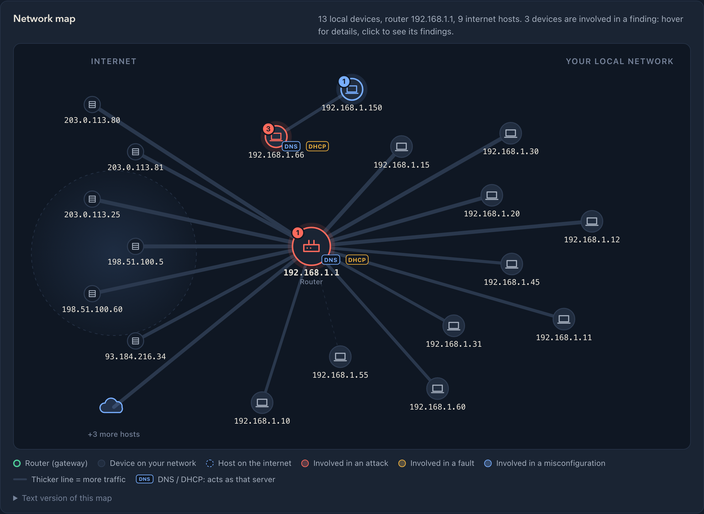 | 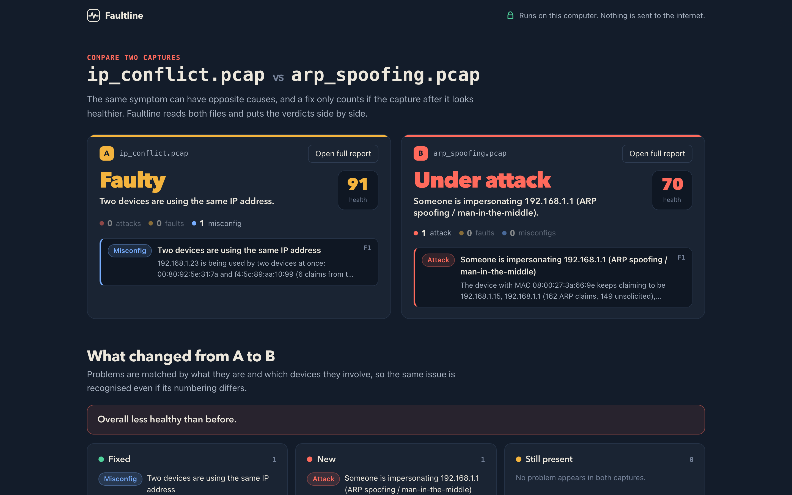 |
| **A fault and an attack in one capture, reported separately** | **Landing page with the labelled sample gallery** |
| 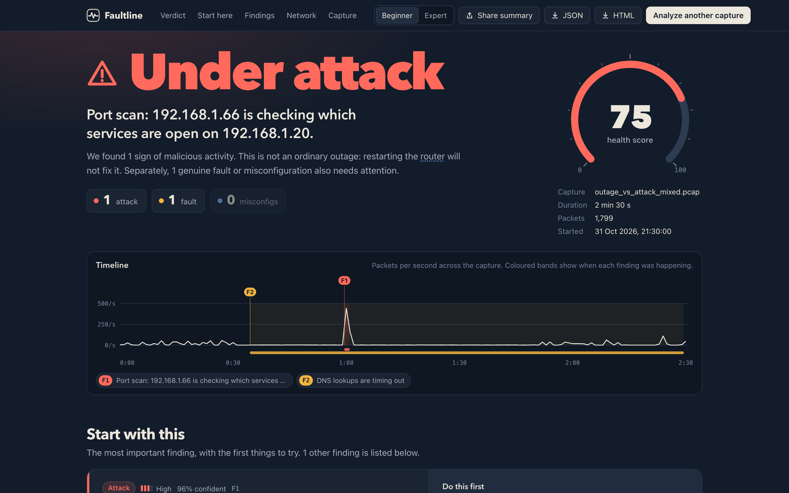 | 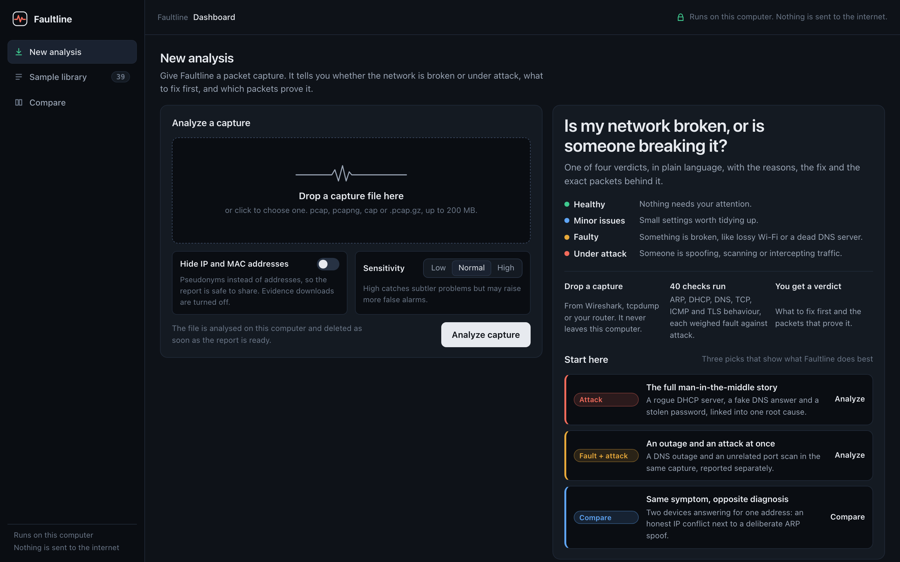 |

Other features of the report: a beginner/expert toggle, plain-language tooltips for technical terms, filters, an expandable evidence table with a Wireshark filter and a per-finding evidence download, and a printable layout. The full-page version is in [`docs/images/web-report-full-mitm.png`](docs/images/web-report-full-mitm.png), and complete interactive reports are in [`docs/examples/`](docs/examples) (download one and open it in a browser).


## Demo video

[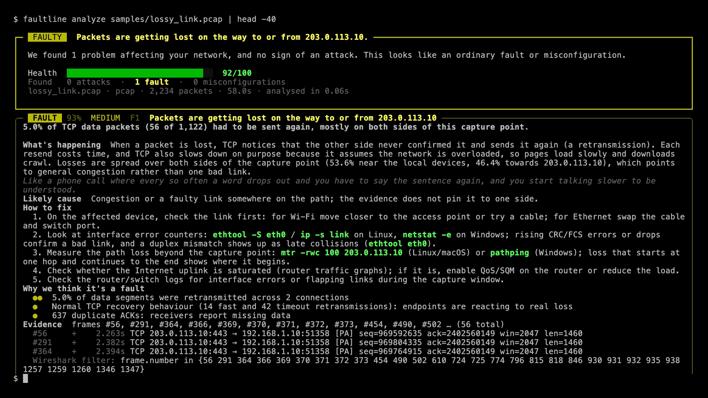](docs/demo/faultline-demo.mp4)

[`docs/demo/faultline-demo.mp4`](docs/demo/faultline-demo.mp4) (3 min 12 s). It covers the problem, the command-line tool on an attack and on a fault, the web dashboard (report, network map, evidence scoreboard, side-by-side comparison), hostile input and redaction, and the evaluation results.

All footage shows the real tool running on the bundled samples. The terminal scenes are recorded with [VHS](https://github.com/charmbracelet/vhs) and the dashboard scenes with Playwright. The narration is a synthesized voice (macOS `say`). The scripts that produced the video are in [`scripts/demo_video/`](scripts/demo_video).

## Design

The reasoning behind these choices, with worked examples and the alternatives we rejected, is in [`docs/THINKING.md`](docs/THINKING.md).

1. **Diagnosis rather than detection.** An alert reports an event. A diagnosis also says how certain it is, what caused it and what to do first. Findings therefore carry cause, fix and evidence, and are grouped into incidents with a root cause.
2. **Competing explanations, decided in one place.** Detectors do not label anything as an attack. They record evidence for each possible explanation (fault, misconfiguration, attack) with a weight. A single engine scores the explanations, picks one, and keeps the others with the reasons they lost. This is how one observation, "two MACs claim one IP", ends up as an IP conflict in one capture and ARP spoofing in another.
3. **Precision over recall.** A tool that reports an attack on a healthy network quickly stops being trusted. Benign look-alikes are part of the benchmark and must produce no finding of medium or higher severity. Examples include an isolated retransmission, a reset after a normal close, a mistyped domain, a traceroute, and ISP routers resolving their customers.
4. **Use the capture point.** A capture sees traffic from one position on the path. Faultline uses that to tell packet loss before the capture point from loss after it, and to split delay into a network part and a server part.
5. **Capture files are untrusted input.** A capture can be truncated, malformed or crafted to crash a parser or inject script into a report. The reader and decoders are our own, bounds-checked and fuzzed. Text from packets is treated as untrusted all the way into the HTML report.
6. **Measure, then publish the numbers.** The project includes a labelled scenario lab, a benchmark with a false-alarm count, and a validation run on public captures with the misses shown. That testing found real defects in our own code: two redaction leaks, an upload limit that rejected normal files, and a false alarm on ISP traffic. Each was fixed and covered by a regression test.

## Why Faultline does not use AI or machine learning

The diagnosis is made by explicit, hand-written rules and a weighted-evidence score, not by a language model or a trained classifier. This was a deliberate choice, not a gap:

- **Local-first and private.** Packet captures contain the most sensitive data a network has: internal addresses, device names, browsing, and sometimes passwords. Faultline never sends any of it anywhere. It needs no cloud API, no account and no key, and it works on an air-gapped lab machine.
- **Explainable by construction.** Every verdict is the sum of named pieces of evidence with fixed weights, and each piece points to specific packets. A beginner can read why a finding is an attack, and an expert can check it in Wireshark. A model's output cannot be traced back to packets like this.
- **Deterministic and reproducible.** The same capture always gives the same answer. That is what makes the benchmark, the regression tests and a before/after `diff` meaningful.
- **No training data problem.** Labelled captures of real attacks on small networks are scarce, and models trained on public datasets tend to learn the lab rather than the attack. Protocol rules, such as "a second DHCP server naming itself as the router", hold on any network.
- **Harder to fool, and safer to run.** Text inside packets is attacker-controlled. Feeding it to a language model would invite prompt injection, while rules only ever treat it as data.
- **Fast and light.** Analysis takes well under a second for typical captures on a laptop, with no GPU and no model download.

The trade-off is that new kinds of problem need new rules. A local, optional model that only rephrases the already-computed findings could be added later without changing how verdicts are made.

## Features

| Area | Details |
|---|---|
| Input | pcap (microsecond and nanosecond, either byte order), pcapng (multiple sections and interfaces, any timestamp resolution), gzip-compressed captures; Ethernet, 802.1Q and QinQ VLANs, Linux SLL and SLL2, raw IP, BSD loopback |
| Decoding | ARP, IPv4 with fragments, IPv6 with extension headers, TCP with options (MSS, window scale, SACK, timestamps), UDP, ICMP and ICMPv6 including the quoted original packet, DNS with safe name decompression, DHCP, TLS handshakes (SNI, versions, alerts), HTTP/1.x, and clear-text logins (FTP, Telnet, POP3, IMAP, SMTP AUTH, HTTP Basic). Roughly 320,000 packets per second on a laptop |
| Faults | Packet loss with location relative to the capture point, connection resets, refused connections, unanswered connection attempts, receive-window stalls, high latency, slow servers, DNS timeouts, errors and slowness, unanswered ARP, missing DHCP server, routing loops, unreachable hosts, broadcast storms, TLS failures, HTTP server errors |
| Misconfigurations | IP address conflicts, a second DHCP server, DHCP NAKs, path-MTU black holes, fragmentation-needed, expired or untrusted certificates, outdated TLS versions, passwords sent in clear text |
| Attacks (mapped to MITRE ATT&CK) | ARP spoofing, rogue DHCP, DHCP starvation, DNS hijacking, DNS tunnelling, algorithmically generated domains, port scans (SYN, connect, FIN/NULL/Xmas, UDP), host, ping and ARP sweeps, SYN and ICMP floods, Smurf, ping of death, ICMP redirects, Teardrop and tiny-fragment evasion, shells on the DNS port, password guessing, web content scans, TCP reset injection |
| Reasoning | Per-finding classification with confidence and "why not" text, incident chains linking root causes to symptoms, health score, overall verdict |
| Explanations | Summary, beginner explanation with an analogy, likely cause, ordered fix steps with commands, and an expert paragraph for every finding |
| Evidence | Frame numbers (Wireshark numbering), a ready-made Wireshark filter, an evidence table, a small evidence capture per finding, host roles (gateway, DNS, DHCP), top talkers, conversations, timeline |
| Interfaces | Terminal report; self-contained interactive HTML report (network map, timeline, evidence scoreboard, beginner and expert views, term tooltips); local web dashboard with a sample gallery and a side-by-side compare view; JSON |
| Automation | Exit codes and `--fail-on` for scheduled checks or CI; `faultline diff` to compare captures before and after a fix |
| Privacy and security | Address pseudonymisation (`--redact`), credentials detected but never extracted, no payload storage, owner-only report files, hardened report and dashboard (see [Security](#security)) |

The full list of 38 finding types, with signals, thresholds and the evidence used to separate faults from attacks, is in [`docs/DETECTORS.md`](docs/DETECTORS.md).

## How it works

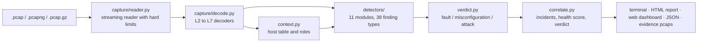

**Single pass.** The reader yields one frame at a time. The decoder turns each frame into a compact record of header fields; payload bytes are not kept. The host table and all detectors see each packet once, and their state is bounded (old flows are evicted, evidence lists are capped). A second, targeted pass re-reads only the frames cited as evidence.

**Classification.** A detector reports an observation together with indicators, each of the form *(text, supported explanation, weight from 0.5 to 3)*, and optional wording for each explanation. [`verdict.py`](faultline/verdict.py) applies the same rule to every detector:
- it adds up the weights for each explanation, plus a 0.5 prior for the detector's default;
- it selects the highest total and converts the margin into a confidence between 50% and 99%;
- it keeps the losing explanations, with their indicators, as the "why not" text shown in the report.

**Worked example.** Two MAC addresses claim one IP address. The indicator texts and weights below are taken from [`detectors/arp.py`](faultline/detectors/arp.py); the scores are from the bundled samples.

| Indicator | Supports | Weight | `arp_spoofing.pcap` | `ip_conflict.pcap` |
|---|---|---|:---:|:---:|
| The suspicious MAC answered ARP for IPs that belong to other devices | attack | 2.5 | yes | |
| The disputed address belongs to the router | attack | 2.0 | yes | |
| The suspicious MAC sent ARP replies nobody asked for | attack | 2.0 | yes | |
| Packets for internet addresses were sent to the suspicious MAC instead of the router | attack | 2.0 | yes | |
| The replies repeat at a fixed interval | attack | 1.0 | yes | |
| The address flipped between the two MACs while the original stayed active | attack | 1.0 | yes | |
| A device probed the address before using it (RFC 5227) | misconfig | 1.5 | | yes |
| Both MACs send their own normal traffic from the address | misconfig | 1.5 | | yes |
| The disputed address is not the router's | misconfig | 1.0 | | yes |
| The suspicious MAC only answered when asked and claims only this address | misconfig | 1.0 + 1.0 | | yes |
| Both MACs answered the same ARP request | misconfig | 1.0 | yes | yes |
| **Outcome** | | | attack 13.0, misconfig 1.0: ARP spoofing (T1557.002), 99% | misconfig 8.0, attack 0.0: IP conflict, 99% |

**Correlation.** [`correlate.py`](faultline/correlate.py) links findings with chain rules. Examples:
- a rogue DHCP server, ARP spoofing or an ICMP redirect, together with DNS hijacking or a leaked password, becomes a man-in-the-middle incident;
- when no DHCP server answers, the DNS and connection failures that follow are marked as consequences;
- after a port scan, the resets and ICMP errors it triggered are marked as side effects;
- an MTU black hole explains the retransmissions it causes.

The health score is 100 minus a penalty for each finding, weighted by severity and confidence. Consequences count at 40%.

## Coverage of the brief

| Challenge point | Approach | Finding types |
|---|---|---|
| Reading captures safely | Own streaming reader. Every length is checked against the remaining bytes and against hard limits: 256 KiB per record, 16 MiB per pcapng block, 10 million packets, 4 GiB per file, 2 GiB after decompression, and a cap on runs of empty records. Corruption produces a warning with the byte offset, and analysis continues on what was read | reader warnings, `capture.malformed` |
| TCP retransmissions and resets | Per-flow tracker for retransmissions (fast, timeout, spurious), duplicate ACKs, gaps, resets, refusals, unanswered connection attempts and window stalls, with loss located relative to the capture point | `tcp.*` |
| DNS failures | Query and response matching per transaction: timeouts with the time a server stopped answering, SERVFAIL and REFUSED, slow resolvers, NXDOMAIN bursts | `dns.timeout`, `dns.errors`, `dns.slow`, `dns.nxdomain` |
| Duplicate IPs and ARP conflicts | Every ARP claim per address, probes, who answered when asked, flip-flops | `arp.duplicate_ip`, `arp.unanswered`, `arp.storm` |
| MTU mismatches | Fragmentation-needed and packet-too-big messages, whether senders adapted, and black holes where large packets vanish without any ICMP message | `mtu.frag_needed`, `mtu.blackhole` |
| Unusual delays | Round-trip time split at the capture point, server processing time, client delay | `latency.high_rtt`, `latency.slow_server` |
| Port scans | SYN, connect, FIN/NULL/Xmas and UDP scans; host, ping and ARP sweeps | `scan.port`, `scan.host_sweep`, `arp.scan` |
| ARP spoofing | Router impersonation, unsolicited replies at a fixed rate, one MAC claiming several addresses, traffic redirected to the impostor | `arp.duplicate_ip` (attack) |
| DNS hijacking | Conflicting answers to one query, answers faster than the network allows, answers from servers that were never asked, public names resolved to a rogue local host | `dns.hijack`, `dns.tunneling` |
| Rogue DHCP servers | A rogue server (same subnet, names itself router and DNS, answers first) versus a misplugged home router (different subnet, public DNS); missing server; NAKs; starvation | `dhcp.*` |
| Telling an outage from an attack | Indicator scoring and incident correlation; `outage_vs_attack_mixed.pcap` contains both and they are reported separately | all |
| Explaining clearly, recommending fixes | Beginner and expert text, cause and ordered fix steps for every finding; a "start here" step for each incident | all |
| Showing the evidence | Frame numbers, Wireshark filter, evidence table, timeline, hosts, conversations, evidence capture per finding | all |

## Comparison with existing tools

Wireshark, Zeek and Suricata are mature, far broader tools, and Faultline does not replace them. It covers a narrower question for a different audience: a non-expert who wants to know what is wrong and whether it is malicious.

| | Wireshark expert info | Zeek | Suricata / Snort | Faultline |
|---|---|---|---|---|
| Flags TCP-level problems | yes | partly, in logs | no | yes |
| Flags attacks | no | with scripts | yes, with signatures | yes, from behaviour |
| States fault, misconfiguration or attack, with reasons | no | no | no | yes |
| Separates root causes from symptoms | no | no | no | yes |
| Plain-language explanation and fix per finding | no | no | no | yes |
| Before/after comparison and shareable redacted report | no | no | no | yes |

This compares default, out-of-the-box behaviour for a non-expert user.

## Usage

```bash
faultline analyze CAPTURE [options]     # .pcap, .pcapng, .cap, .pcap.gz
faultline web [--host 127.0.0.1] [--port 8765] [--no-browser]
faultline diff BEFORE.pcap AFTER.pcap
faultline lab [samples/]                # regenerate the labelled sample captures
faultline bench [samples/]              # run the benchmark
python -m faultline ...                 # without installing the console script
```

| `analyze` option | Effect |
|---|---|
| `--html FILE` | Self-contained interactive HTML report (no external resources; file mode 0600) |
| `--json FILE` | Full report as JSON (`-` for standard output) |
| `--evidence-dir DIR` | One small evidence capture per finding |
| `--redact` | Replace IP and MAC addresses with consistent pseudonyms (HMAC-SHA256 with a random per-run key); evidence captures are not written |
| `--sensitivity low\|normal\|high` | Scale detection thresholds (×1.6, ×1.0, ×0.6) |
| `--expert` | Technical details, all indicators, informational notes, host table |
| `--fail-on attack\|fault\|any` | Exit with status 1 if such findings of medium severity or higher exist |
| `--quiet`, `--no-color`, `--max-packets N`, `--no-evidence` | Output and resource controls; `NO_COLOR` is honoured |

Exit status: 0 analysed, 1 `--fail-on` condition met, 2 unusable input (with a one-line reason).

## Sample captures

The 37 samples in [`samples/`](samples) were generated by our scenario lab ([`faultline/lab/`](faultline/lab)): synthetic office traffic written byte by byte with correct checksums (checked with `tcpdump`). Each problem sits inside ordinary background traffic (DNS, HTTPS, ARP, NTP, DHCP). They contain no real user data, and `faultline lab` regenerates identical files. Expected results are in [`samples/labels.json`](samples/labels.json).

| Group | Captures |
|---|---|
| Healthy | `clean_office`, `busy_but_healthy`, `pcapng_office`, `xss_payload` (packet text fields contain HTML and JavaScript) |
| Faults | `lossy_link`, `server_down_timeouts`, `zero_window`, `slow_server`, `high_latency`, `dns_failure`, `dhcp_no_server`, `routing_loop` |
| Misconfigurations | `connection_refused`, `mtu_blackhole`, `mtu_frag_needed`, `ip_conflict`, `dhcp_misconfig_two_routers`, `cleartext_creds`, `tls_failures` |
| Attacks | `arp_spoofing`, `port_scan`, `host_sweep`, `dns_hijack`, `rogue_dhcp`, `syn_flood`, `dns_tunnel`, `web_bruteforce`, `dns_backdoor`, `teardrop`, `mitm_chain` |
| Fault and attack together | `outage_vs_attack_mixed` |
| Malformed files | `malformed/truncated`, `bad_magic`, `huge_caplen`, `zero_length`, `corrupt_packets`, `compressed_padding.pcap.gz` |

## Evaluation

### Labelled benchmark

`faultline bench` runs every labelled capture through the full engine and checks three things:
- each expected finding is present, with the expected classification;
- nothing else of medium or higher severity is reported;
- malformed files do not crash the tool.

The table is the command's output in Markdown form.

| Capture | Expected | Detected | Correct classification | False alarms | Result |
|---|---|---|---|---|---|
| `arp_spoofing.pcap` | `arp.duplicate_ip` (attack) | 1/1 | 1/1 | 0 | pass |
| `busy_but_healthy.pcap` | nothing | - | - | 0 | pass |
| `clean_office.pcap` | nothing | - | - | 0 | pass |
| `cleartext_creds.pcap` | `cred.cleartext` (misconfig) | 1/1 | 1/1 | 0 | pass |
| `connection_refused.pcap` | `tcp.refused` (misconfig) | 1/1 | 1/1 | 0 | pass |
| `dhcp_misconfig_two_routers.pcap` | `dhcp.multiple_servers` (misconfig) | 1/1 | 1/1 | 0 | pass |
| `dhcp_no_server.pcap` | `dhcp.no_server` (fault) | 1/1 | 1/1 | 0 | pass |
| `dns_backdoor.pcap` | `dns.non_dns_traffic` (attack) | 1/1 | 1/1 | 0 | pass |
| `dns_failure.pcap` | `dns.timeout`, `dns.errors` (fault) | 2/2 | 2/2 | 0 | pass |
| `dns_hijack.pcap` | `dns.hijack` (attack) | 1/1 | 1/1 | 0 | pass |
| `dns_tunnel.pcap` | `dns.tunneling` (attack) | 1/1 | 1/1 | 0 | pass |
| `high_latency.pcap` | `latency.high_rtt` (fault) | 1/1 | 1/1 | 0 | pass |
| `host_sweep.pcap` | `arp.scan` (attack) | 1/1 | 1/1 | 0 | pass |
| `ip_conflict.pcap` | `arp.duplicate_ip` (misconfig) | 1/1 | 1/1 | 0 | pass |
| `lossy_link.pcap` | `tcp.retransmissions` (fault) | 1/1 | 1/1 | 0 | pass |
| `malformed/bad_magic.pcap` | handled without crash | handled | - | 0 | pass |
| `malformed/compressed_padding.pcap.gz` | handled without crash | handled | - | 0 | pass |
| `malformed/corrupt_packets.pcap` | handled without crash | handled | - | 0 | pass |
| `malformed/huge_caplen.pcap` | handled without crash | handled | - | 0 | pass |
| `malformed/truncated.pcap` | handled without crash | handled | - | 0 | pass |
| `malformed/zero_length.pcap` | handled without crash | handled | - | 0 | pass |
| `mitm_chain.pcap` | `dhcp.multiple_servers`, `dns.hijack` (attack), `cred.cleartext` (misconfig) | 3/3 | 3/3 | 0 | pass |
| `mtu_blackhole.pcap` | `mtu.blackhole` (misconfig) | 1/1 | 1/1 | 0 | pass |
| `mtu_frag_needed.pcap` | `mtu.frag_needed` (misconfig) | 1/1 | 1/1 | 0 | pass |
| `outage_vs_attack_mixed.pcap` | `dns.timeout` (fault), `scan.port` (attack) | 2/2 | 2/2 | 0 | pass |
| `pcapng_office.pcapng` | nothing | - | - | 0 | pass |
| `port_scan.pcap` | `scan.port` (attack) | 1/1 | 1/1 | 0 | pass |
| `rogue_dhcp.pcap` | `dhcp.multiple_servers` (attack) | 1/1 | 1/1 | 0 | pass |
| `routing_loop.pcap` | `icmp.routing_loop` (fault) | 1/1 | 1/1 | 0 | pass |
| `server_down_timeouts.pcap` | `tcp.syn_timeout`, `arp.unanswered` (fault) | 2/2 | 2/2 | 0 | pass |
| `slow_server.pcap` | `latency.slow_server` (fault) | 1/1 | 1/1 | 0 | pass |
| `syn_flood.pcap` | `flood.syn` (attack) | 1/1 | 1/1 | 0 | pass |
| `teardrop.pcap` | `ip.fragment_attack` (attack) | 1/1 | 1/1 | 0 | pass |
| `tls_failures.pcap` | `tls.failure` (misconfig) | 1/1 | 1/1 | 0 | pass |
| `web_bruteforce.pcap` | `http.errors` (attack) | 1/1 | 1/1 | 0 | pass |
| `xss_payload.pcap` | nothing | - | - | 0 | pass |
| `zero_window.pcap` | `tcp.zero_window` (fault) | 1/1 | 1/1 | 0 | pass |

Summary: 32 of 32 detected, 32 of 32 correctly classified, 0 false alarms, 4 of 4 healthy captures quiet, 6 of 6 malformed files handled; 52,478 packets in about 1.5 seconds.

### Public captures

To check behaviour on traffic we did not generate, [`scripts/validate_public.py`](scripts/validate_public.py) runs Faultline on sample captures published by the Wireshark project. It downloads them, verifies each against a pinned SHA-256 hash, and scores the result against what the capture is documented to contain. The captures are not redistributed in this repository.

| Capture | Content | Faultline | Result |
|---|---|---|---|
| `nmap_standard_scan`, `nmap_OS_scan`, `nmap_OS_scan_succesful` | Nmap scans | `scan.port`, attack | correct |
| `nmap_ACK_scan_on_port_80_2` | Nmap with tiny fragments and a spoofed source | `ip.fragment_attack`, attack | correct |
| `teardrop.cap` | Teardrop overlapping fragments | `ip.fragment_attack`, attack | correct |
| `dns-remoteshell.pcap` | A Windows command shell over TCP port 53 | `dns.non_dns_traffic`, attack | correct |
| `telnet-raw.pcap`, `telnet-cooked.pcap`, `tcp-ecn-sample.pcap` | Telnet logins; a router admin page using HTTP Basic authentication | `cred.cleartext` | correct |
| `arp-storm.pcap` | ISP routers resolving many customers | no attack reported | correct |
| `dns.cap`, `http.cap`, `dhcp.pcap`, `dhcp-and-dyndns.pcap.gz`, `v6.pcap`, `ipv4frags.pcap`, `nfs_bad_stalls.cap` | Ordinary traffic | healthy | correct |
| `zlip-1.pcap`, `zlip-2.pcap`, `zlip-3.pcap` | DNS decompression exploits | parsed without error | correct |
| `nmap_ACK_scan_on_port_80` | A six-packet ACK probe of one port | not detected | missed |
| `nmap_zombie_scan` | Idle (zombie) scan | not detected | missed |

20 of 22 correct, no false alarms, no crashes. The first run of this validation found one false alarm (the ISP routers had been reported as an ARP scan) and two gaps (Teardrop, and a shell on the DNS port). All three were fixed and added to the lab and the test suite.

### Recorded runs

The images in [`docs/proof/`](docs/proof) show the verification commands being run. The PNG files are screenshots of a macOS Terminal window. The SVG files are recordings of each command's output, which [`scripts/make_proof.py`](scripts/make_proof.py) regenerates by running the commands again.

| Analysis of an attack capture | Test suite and benchmark (339 tests at the time of this screenshot) |
|---|---|
|  | 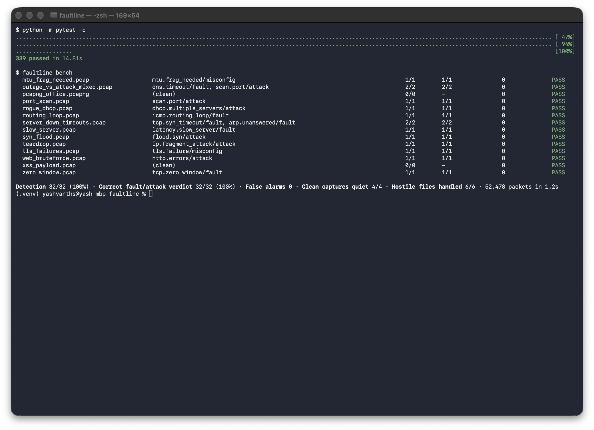 |
| **Fuzzing and secret scan** | **Public captures** |
| 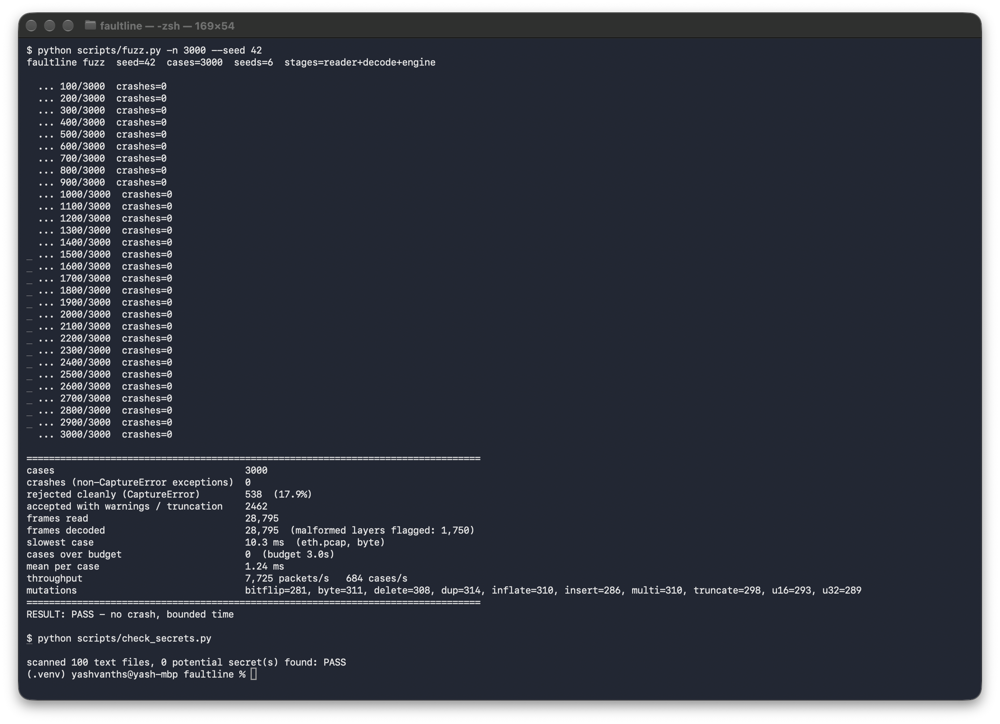 | 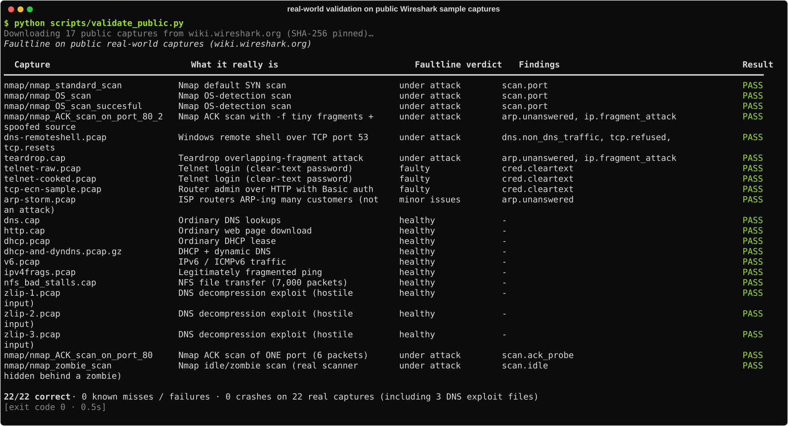 |

<details>
<summary>Further recordings</summary>

| Command | Recording |
|---|---|
| `pytest -q` | 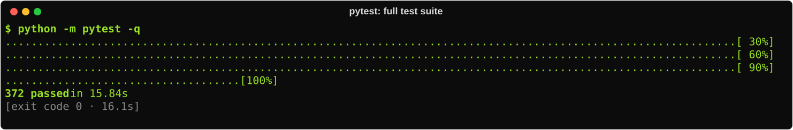 |
| `faultline bench` | 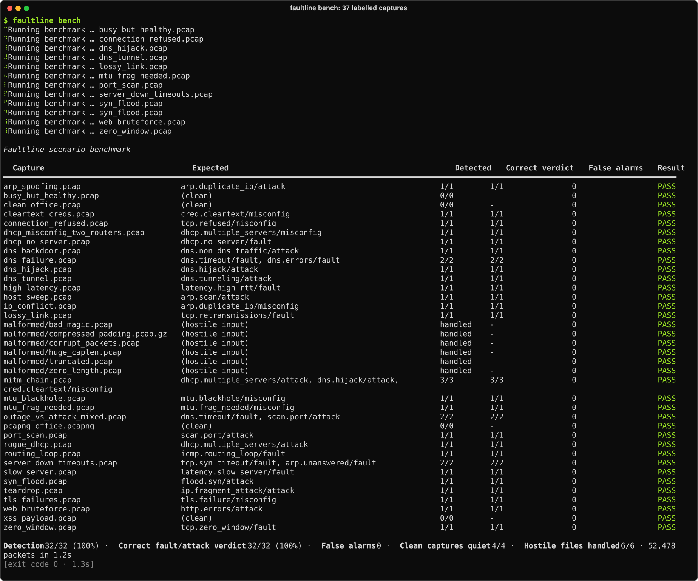 |
| `python scripts/fuzz.py -n 3000 --seed 42` | 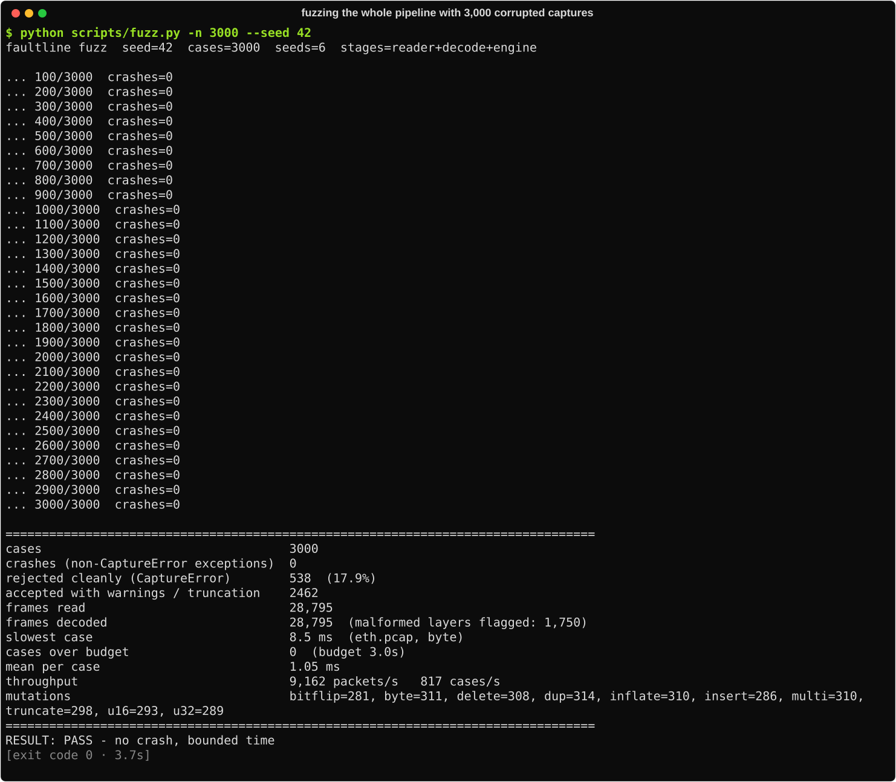 |
| Malformed and hostile files | 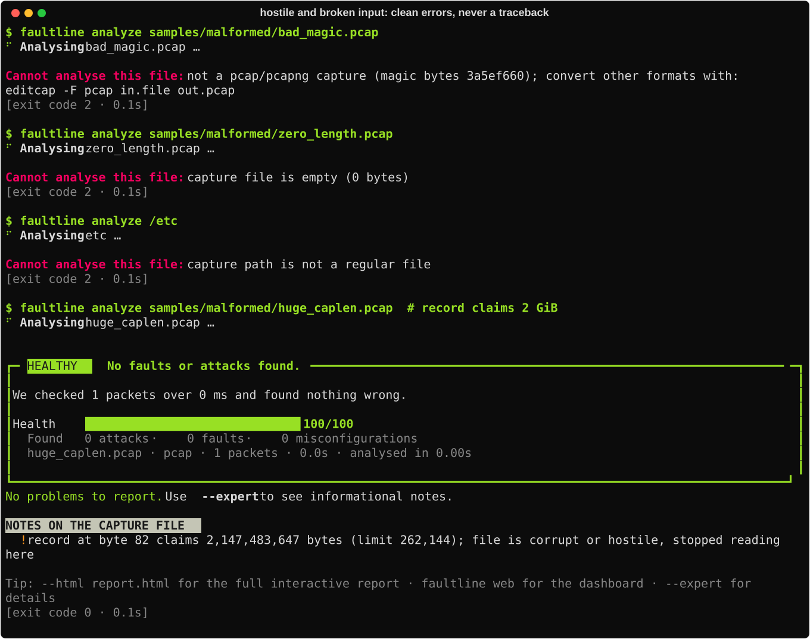 |
| `faultline analyze ... --redact` | 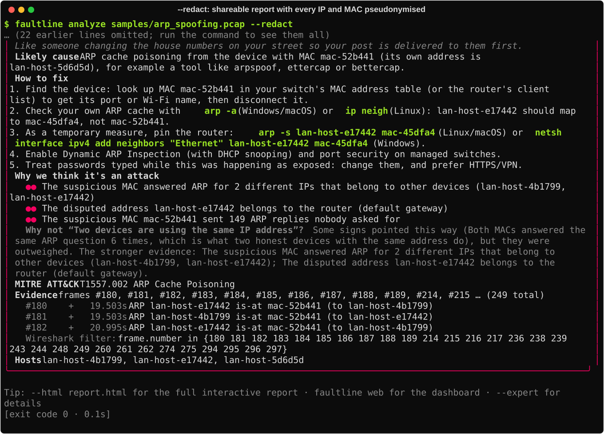 |
| `python scripts/check_secrets.py` | 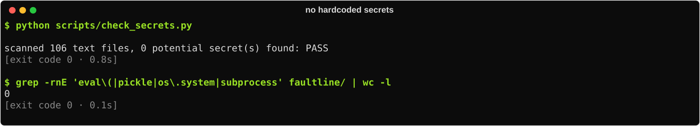 |

</details>

### Reproducing the results

```bash
pip install -e ".[dev]"
pytest -q                                   # 357 tests
faultline bench                             # labelled benchmark
python scripts/validate_public.py           # public captures (downloads about 1.5 MB once, cached in ~/.cache/faultline)
python scripts/fuzz.py -n 3000 --seed 42    # fuzzing
python scripts/check_secrets.py             # secret scan
python scripts/make_proof.py                # regenerate docs/proof
```

## Security

Capture files and everything inside them are treated as untrusted. The threat model and the mitigations, with file references, are in [`SECURITY.md`](SECURITY.md).

- **Reader:** format and version checks; every length validated against the bytes present and against hard limits; gzip streamed through a decompression limit; corruption reported with a byte offset instead of an exception. Unusable files exit with status 2 and a one-line reason.
- **Decoders:** all reads are bounds-checked. DNS name decompression rejects loops and forward pointers. Option and TLV loops are capped. A damaged packet is flagged and skipped.
- **Fuzzing:** [`scripts/fuzz.py`](scripts/fuzz.py) applies ten mutation types to valid captures and runs the full pipeline: 0 crashes in 3,000 cases, slowest case under 20 ms. A smaller run is part of the test suite.
- **Data handling:**
  - payload bytes are not stored;
  - clear-text credentials are reported by protocol only, never extracted or displayed;
  - `--redact` pseudonymises every IP and MAC address (checked on every sample);
  - report files are created readable by the owner only.
- **HTML report:** packet-derived data is embedded as escaped JSON and rendered through `textContent` only. A Content-Security-Policy pins the single script and stylesheet by hash. There are no external resources. `samples/xss_payload.pcap` contains script and event-handler payloads in DNS, DHCP, HTTP and TLS fields, and they render as text.
- **Web dashboard:**
  - binds to 127.0.0.1 and rejects foreign `Host` headers;
  - CSRF token on uploads;
  - size limit, plus extension and file-signature checks;
  - uploads go to a random temporary file that is deleted after analysis, and reports are not stored;
  - restrictive security headers and generic error pages;
  - at most two concurrent analyses.
- **Code:** no network access at runtime (the public-capture script is an optional tool, not part of the analyser), no telemetry, no `eval`, `pickle` or shell execution, no secrets. [`scripts/check_secrets.py`](scripts/check_secrets.py) scans the repository.

## Project structure

```
faultline/
  capture/      reader.py (pcap, pcapng, gzip), decode.py (L2 to L7), writer.py
  detectors/    tcp, latency, mtu, arp, dhcp, dns, scan, flood, icmp, app, protocol
  model.py      packet, finding, indicator and incident types
  context.py    host table, roles, sensitivity
  verdict.py    fault / misconfiguration / attack scoring
  correlate.py  incidents, health score, overall verdict
  engine.py     analysis pipeline
  report/       HTML report and redaction
  web/          local dashboard
  lab/          packet builder and labelled scenarios
  bench.py, diff.py, cli.py
samples/        37 labelled captures and labels.json
tests/          357 tests
scripts/        fuzz.py, check_secrets.py, validate_public.py, make_assets.py, make_proof.py, make_web_shots.py
docs/           THINKING.md, DETECTORS.md, demo-script.md, images/, examples/, proof/
```

About 22,000 lines of Python, including tests, written during the hackathon.

## Libraries used

The analysis engine (reader, decoders, detectors, classification, correlation) uses only the Python standard library: `struct`, `socket`, `ipaddress`, `gzip`, `zlib`, `io`, `os`, `stat`, `hashlib`, `base64`, `collections`, `dataclasses`, `enum`, `functools`, `math`, `statistics`, `array`, `random`, `time`, `datetime`, `typing`, `importlib`. The report, dashboard and scripts also use `json`, `html`, `hmac`, `secrets`, `re`, `tempfile`, `threading`, `argparse`, `unicodedata` and `urllib`.

| Third-party library | License | Purpose |
|---|---|---|
| [rich](https://github.com/Textualize/rich) | MIT | Terminal output |
| [Flask](https://github.com/pallets/flask), with Werkzeug, Jinja2, MarkupSafe, itsdangerous, click, blinker | BSD-3-Clause / MIT | Local web dashboard |
| [pytest](https://github.com/pytest-dev/pytest) | MIT | Tests (development only) |
| [Playwright](https://github.com/microsoft/playwright-python) | Apache-2.0 | Optional: README screenshots of the dashboard (`scripts/make_web_shots.py`); not needed to run Faultline |

Not used: Wireshark, tshark, pyshark, Scapy, dpkt, Zeek, Suricata, or any external API or network service. Capture parsing, protocol decoding, detection and diagnosis are our own code.

## Responsible use

Faultline is a defensive tool. Analyse only captures from networks you own or are authorised to examine, and use `--redact` before sharing a report. The scenario lab writes synthetic packets to files and never transmits anything.

## Limitations

- **Encrypted traffic.** Only TLS handshake metadata is examined. Anything inside an encrypted session is invisible to Faultline.
- **Stealth scans.** A single-port ACK probe and an idle (zombie) scan, both in the public Nmap captures, are not detected. The first is indistinguishable from mid-connection traffic; the second hides the scanner behind a third host.
- **Single capture point.** Loss location and delay attribution assume one vantage point. Captures merged from several points will mislead them.
- **Heuristic thresholds.** They are tuned for precision on our lab and on the public captures above. `--sensitivity` adjusts them, but unusual networks may need tuning.
- **Files only.** There is no live-capture mode.
- **Protocol coverage.** IPv6 neighbour-discovery spoofing, DHCPv6, QUIC and SMB are not analysed.

## License

MIT. See [`LICENSE`](LICENSE).
